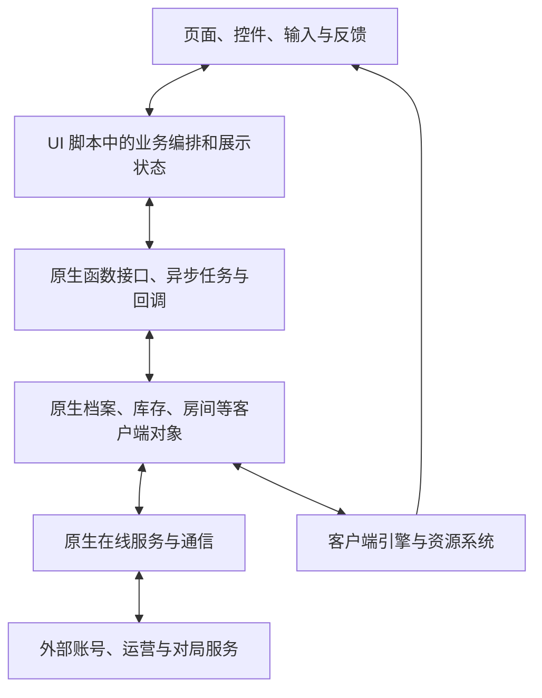

# 原生客户端功能模块地图

调查日期：2026-10-23。对象：1649370 固定版本客户端。

## 1. 范围与阅读方法

本文按职责整理主要功能，不是原厂架构图，也不声称穷尽 EXE 中所有模块。模块名称为调查分类，不代表原版存在同名目录或独立组件。一个业务可能同时跨越 UI 脚本、原生 EXE 和外部服务；不能按 Controller、Service 名称直接认定分层。

本次只读检查现有反编译脚本、当前适配代码及历史研究，没有启动游戏或新增动态跟踪。反编译源码用于定位职责；精确控制流、字段含义和 Hook 方案仍须回到原始字节码或原生指令核验。

证据标记：**脚本**表示相关职责在脚本函数和调用中可见；**适配**表示当前重建代码有对应实现，不等于原版全链路或实机功能已经验证；**研究**表示已有原生静态分析或历史动态记录；**待查**表示边界或实现仍不明确。

## 2. 总体关系

这是信息与调用关系示意，不是源码导入方向。外部服务框表示依赖边界，不表示已证明原版采用几个独立服务。

当前重建另有 Python 应用层和 HTTP/WS 适配：它们在选定原生入口接管部分流程，不是上述全部原生模块的替代品。游戏进程仍有断网限制，自建业务通信由 Python 宿主完成。

## 3. 主要功能模块与职责

下表中的“未接入”指当前重建业务尚未完整接入，不等于原生程序没有该能力。

| 模块 | 原生可见职责及主要边界 | 主要关系 | 当前接入情况 | 证据 |
|---|---|---|---|---|
| 界面框架与导航 | 页面切换、事件广播、数据绑定、弹窗、异步任务等待和完成；脚本也会主动编排业务，不能视为纯显示 | 承载各业务页面，调用原生桥 | 复用原版，局部页面与空值保护补丁 | 脚本：PageNavigationController、ServiceBase、DataManager、EventManager、AsyncTaskManager |
| 登录、身份与新手进入 | 登录错误展示、创建昵称/角色任务、进入游戏、新手引导；账号认证的完整原生及远端流程待查 | 档案、主界面、在线服务 | 自建服务端登录已接入；本地档案供应替代部分在线依赖；auth 拆分尚未实施 | 脚本：LoginController、LoginService、OnboardController；适配：room/service.py |
| 账号档案、成长与玩家资料 | 档案就绪/保存、等级成长、生涯统计、名片、其他玩家基本资料查询；展示资料不等于全部权威账号数据 | 背包、社交、房间、结算 | 本地双档案加载保存、初始化、昵称和部分成长策略已接入；不是完整原版在线档案服务 | 脚本：CareerController、PlayerBasicInfoController；适配：profile_bridge、profile_codec |
| 库存、角色与武器配装 | 物品列表、拥有状态消费、角色选择、装备槽、武器附件、技能和配装命名；与物品获取交易分开 | 档案、商城、预览、对局装备 | 复用大量原生配装能力，供应本地库存并保存档案；背包改名复用原生写入 | 脚本：CharacterLoadOutController、WeaponLoadOutController；适配：profile、sanitize |
| 角色与武器展示 | 模型预览、试穿、场景可见性、阵营和动画状态；负责展示，不决定是否拥有物品 | 库存、商城、房间，依赖渲染与资源 | 保留原生预览，补齐档案和角色缓存的准备顺序 | 脚本：UIViewerController；适配：viewer、profile 的初始化桩 |
| 商城、交易与货币 | 商品、SKU、购物车、报价、购买任务、权益变化及道具兑换；余额/授权写入与展示需分别分析 | 库存、档案、运营服务 | 接入有限本地 GP/CP 购买、CP 充值与改名卡消费；没有完整复原所有原版商品渠道 | 脚本：MarketController、MarketService；适配：purchase、ui_recharge、player_name |
| 大厅、频道与匹配 | 模式选择、房间搜索、频道和匹配状态、加入条件及匹配任务 | 房间、小队、地图内容资格、对局连接 | 自建房间列表与入房已接入；不能据此声称自动匹配和排位完整可用 | 脚本：MatchController、MatchService；适配：room_list |
| 房间与成员 | 房间设置、成员数组、房主/准备/队伍状态、投票及角色资料刷新；原生还含自动设置提交行为 | 匹配、小队、档案、开局 | 创建/加入/退出、入房快照及设置提交已接入；持续 WS 成员同步、准备、换队、踢人等未完整接通 | 脚本：LobbyController；研究：room-config-native-findings；适配：room、multiplayer_bridge |
| 小队与邀请 | 小队成员、邀请、队长变更、小队踢人及跨房间关系；小队不是房间 | 好友、匹配、房间 | 尚未完整接入自建服务端；小队踢人不能当作房间踢人证据 | 脚本：PartyController、PartyService、InvitationController |
| 好友、联系人与战队 | 好友、最近玩家、黑名单、战队申请与邀请、职位和成员资料 | 玩家身份、聊天、小队、运营奖励 | 尚未完整接入；界面入口存在不表示请求可完成 | 脚本：ContactController、ClanController、ClanService |
| 聊天、语音与消息 | 聊天频道、消息收发、私聊、喇叭、语音控制及通知；实际语音 SDK 和传输边界待查 | 身份、社交、房间，依赖网络与音频 | 未完整接入；离线字符串净化适配不能等同聊天服务恢复 | 脚本：ChattingController、GVoiceController、QTalkController、MailController、ServerMsgController |
| 任务、奖励与运营内容 | 挑战、奖励兑换、补给、优惠券、活动通知及运营内容更新；发放权威与最终落档需单独确认 | 商城、成长、发布者内容、结算 | 部分展示与离线保护；每周奖励补丁只改展示，不执行发奖 | 脚本：ChallengeController、RewardController、CouponController、PublisherStorageController；适配：ui_weekly_rewards、local_ui_services |
| 排位、排行榜与赛事 | 排位状态、赛季资料、排行榜和赛事相关界面；战斗规则和服务端判定不能由页面推断 | 匹配、成长、战队、结算 | 存在空赛季/缺失服务保护，不能视为排位系统复原 | 脚本：WarGodController、LeaderboardController、TournamentLeaderboardController、BattleCityLeagueController |
| 对局进入、连接与加载 | 开局任务、寻找服务器、地图连接准备及加载交接；房间创建成功不等于可进入战斗 | 房间、地图资源、网络、引擎 | 有专项研究，尚无完整多人对局验收 | 脚本：LoginService.jumpGame、CFunctionContainer.JumpGame；研究：pvp-host-findings |
| 战斗客户端与 HUD | 对局帧、快照消费、战斗界面与模式状态；移动预测、武器、碰撞等详细内部责任尚未系统划界 | 对局服务器、地图、输入、渲染音频 | 原生客户端引擎存在；完整战斗同步未接入 | 脚本：InGameService、CFunctionInGameContainer；研究：pvp-host-findings |
| 结算与战后统计 | 战后结果、成长和奖励展示；展示结果与计算/授予奖励是不同职责 | 战斗、档案、奖励、返回大厅 | 没有完整接入服务端结算；已有退出页面保护不等于结算实现 | 脚本：SummaryController、SummaryBaseController、LobbySummaryController、MainMenuAARController；适配：ui_navigation |
| 设置、输入与设备 | 图像、分辨率、音量、麦克风、按键输入及设置页面；应用设置与保存文件分开 | UI、引擎、设备、文件 | 原生解释设备设置；重建侧保存和恢复设置文件 | 脚本：OptionController、OptionVideoController、StageKeyController、LanguageBarController；当前架构文档 |
| 资源、渲染与运行基础 | 资源加载、模型纹理/地图供应、画面与音频执行、进程帧循环；具体原生子系统边界待进一步分析 | 支撑全部模块 | 保留原生执行；重建侧补齐资源供应、启动和调试机制，没有重写完整引擎 | 适配：viewer、image；研究：pvp-host-findings；当前 resources/runtime/platform 代码仅为重建实现，不能当作原版组织结构 |
| 在线服务、原生桥与协议 | UI 原生函数绑定、异步任务、账号/社交/交易服务调用及对局通信；业务在线通道与战斗通道需分别研究 | 贯穿业务和引擎 | 选定调用处 Hook，Python HTTP/WS 替代部分业务连接；原版线协议未完整还原 | 脚本：CFunctionContainer、CFunctionCommonContainer、ServiceBase；适配：session_bridge、multiplayer_bridge |

投诉、问卷、截图、视频、反机器人及自动化测试相关 Controller 也存在。当前只将其记为外围功能线索，尚未逐项核对到足以定义独立大模块的程度；不能据命名推断完整反作弊系统或安全服务实现。

## 4. 最容易混淆的边界

1. **房间和小队分开。** Party 管组队关系，Lobby 管具体房间；同一玩家可能同时参与两套状态。
2. **库存和商城分开。** 库存提供持有与装备数据，商城处理交易；交易完成后才需要协调库存和余额更新。
3. **档案初始化和新手奖励分开。** 当前本地初始授权是自定义策略，尚未与原版新手发奖流程建立一一对应。
4. **界面显示和业务提交分开。** LobbyController 成员刷新中存在设置提交路径；接收服务端结果不能未经核对直接复用带写入副作用的入口。
5. **战斗客户端和权威宿主分开。** 已有研究看到客户端引擎及本机服务器相关分支，但没有证明完整权威宿主可用，也不能断言所有宿主代码均不存在。
6. **协议与原生显示结构分开。** cppSetRoomMembers 等是客户端内部接口，不等于服务器网络消息格式。
7. **模块存在和可运行分开。** 脚本存在、原生函数声明、适配代码存在、实机成功是不同等级的证据。

## 5. 我们目前接管到什么程度

| 范围 | 接管方式 | 仍需注意 |
|---|---|---|
| 本地档案与初始授权 | 自定义数据供应和持久化，适配原生结构 | 保留原生缓存与展示；不声称还原原版账号后台 |
| 本地购买、充值、改名 | 应用规则与原生发布/持久化共同完成 | 不是所有步骤均在应用层；结果回调是否有额外副作用须逐项确认 |
| 房间创建、加入、退出 | 截取原生请求，经自建 HTTP 执行，再接回原生完成流程 | 入房快照不代表持续同步；回显和自动提交之间存在待梳理边界 |
| 房间设置 | 原生应用设置，同时异步向自建服务端提交 | 属于旁路同步，失败后不能假定双方一致；不能把内部调用全视为玩家主动操作 |
| 界面保护和外观修正 | 特定方法的会话内补丁 | 不代表相应业务系统已被接管或完整恢复 |
| WS | 连接、接收、保活和重连 | 当前没有完整房间事件应用链；不能据连接成功认定实时业务可用 |

## 6. 证据入口

路径均相对本文所在目录。脚本为提取的研究材料，不是生产依赖。

- [原版 UI 脚本目录](../../research/client/ui-investigation/source/scripts/codo/)：controllers、services、objects、tasks、manager 和 common。
- [原生 UI 函数接口](../../research/client/ui-investigation/source/scripts/codo/common/CFunctionContainer.as)、[公共接口](../../research/client/ui-investigation/source/scripts/codo/common/CFunctionCommonContainer.as)、[战斗 UI 接口](../../research/client/ui-investigation/source/scripts/codo/common/CFunctionInGameContainer.as)。这些声明不证明底层实现完整可达。
- [UI 任务编排基础](../../research/client/ui-investigation/source/scripts/codo/base/ServiceBase.as)、[房间控制器](../../research/client/ui-investigation/source/scripts/codo/controllers/LobbyController.as)、[小队控制器](../../research/client/ui-investigation/source/scripts/codo/controllers/PartyController.as)。
- [房间原生配置与 UI 提交研究](../../research/room-config-native-findings.md)：优先阅读后面的复核和更正，不能把早期推断当作最终结论。
- [原生对局引擎和本机宿主研究](../../research/pvp-host-findings-20261019.txt)：历史研究含版本和范围限定，旧路径引用不保证仍有效；本文不据此宣称当前对局已可运行。
- [当前版本适配代码](../src/codol_rebuild/adapters/game/v1649370/)、[当前应用层](../src/codol_rebuild/application/)、[当前客户端架构](架构设计.md)：用于确定重建侧现状，不代替原版架构证据。

## 7. 未知范围与后续使用方式

尚未完整确认：原版全部协议、完整账号及交易远端流程、所有房间自动行为、对局权威宿主可达性、各战斗子系统内部划分、完整反作弊和第三方平台组件职责。本地图不构成功能验收，也不能直接据此批准新的 Hook 或生产模块。

后续接入某个模块时，再建立该模块的“用户命令入口—原生自动行为—服务端结果回显—状态所有者”边界。优先梳理当前已接入的档案/交易和大厅/房间；无需先把全部 EXE 逆向完毕，也不能在模块地图层面就假定所有原生业务应被重写。
