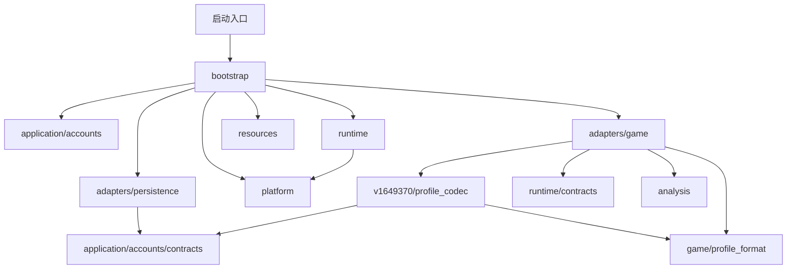
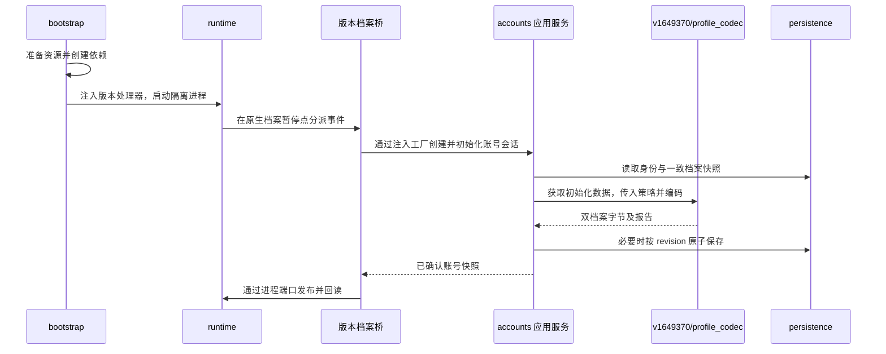
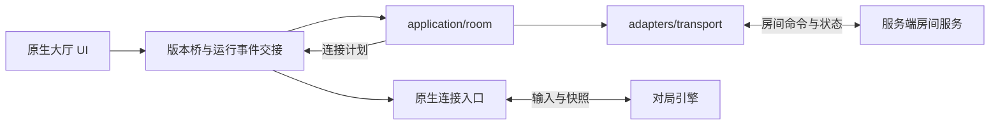

# 客户端架构设计

本文约定客户端模块的职责、依赖方向、状态归属和数据流，作为修改代码的依据。

原版客户端的主要功能、职责及当前接管情况见[原生客户端功能模块地图](原生客户端功能模块地图.md)。该地图是研究分类，不代表原厂源码分层，也不替代本文件的重建代码边界。


## 1 设计范围

当前实现面向 Windows 上的 1649370 客户端离线运行与本地档案。源码已按应用、外部适配、资源、平台、运行与装配职责组织。原生客户端继续负责 UI、房间对象、角色模型、档案消费和设备设置解释。

联机采用“本地账号与背包、服务端房间与对局”的分工。`application/session/` 管理登录、身份及 WS 生命周期，`application/room/` 处理创建、加入、退出房间及准备命令，`adapters/transport/` 实现通信。加入适配发布成员与设置快照，成员事件触发持续同步；战斗尚未接入。原生加入流程仍需双客户端实机验收。当前也没有通用多版本运行框架。

准备命令在现有 `adapters/game/v1649370/rooms/room.py` 中接管 `SetReadyState`、`GetReadyState` 两个 GFx 专用虚表槽，仅在服务端房间有效时启用；房外仍调用原处理器。本人状态读取原生成员第一槽（发布器保证本人在首位），不再依赖原版登录对象。用户请求由应用层提交绝对布尔值，服务端确认前不改变成员准备字段。成员回显期间的派生准备调用不提交请求；完整列表发布后沿原生 `cppSetMemberReadyState` 通知路径更新确认状态、解除请求锁及刷新按钮。此前在途的成员查询、换队和踢人快照先消费，准备结果后消费，避免旧快照覆盖确认状态。接口失败沿用现有错误提示，并以此前确认状态完成原生请求锁，不自动重试或查询恢复。入房默认未准备，不新增仓库锁定或开局逻辑；原版全员准备时的按钮行为保留。

## 2 目录与职责

客户端磁盘目录按固定运行文件、持久数据和工作产物划分。下表路径相对于 `client/`；这些目录不新增源码架构层级。

| 目录 | 职责 | 边界 |
|---|---|---|
| `bin/` | 固定运行程序和组件 | 由启动装配使用；需要会话补丁的程序先复制到会话目录，不修改固定基底 |
| `resources/` | 固定运行资源及校验清单 | 由准备工具发布、资源层校验、bootstrap 装配；不承载源码、可执行组件或用户存档 |
| `data/` | 跨会话保存的账号、档案和设置 | 由持久化适配器管理、bootstrap 注入路径；不随缓存清理或资源重建而覆盖 |
| `workspaces/` | 构建中间材料、缓存和运行会话产物 | 按用途管理生命周期；清理须考虑工具及会话引用，不得遍历资源联接或删除跨会话数据 |

磁盘目录 `client/resources/` 存放运行数据，源码包 `client/src/codol_rebuild/resources/` 实现资源解析、供应和校验；`data/` 的业务和存储逻辑仍属于现有应用层与适配器。具体资源内容、处理流程与清单约定见[固定版本资源说明](../resources/v1649370/README.md)，工作产物说明见[工作目录说明](../workspaces/README.md)。

以下源码路径相对于 `client/src/codol_rebuild/`。

```text
codol_rebuild/
  application/
    accounts/
    broadcast/          大小喇叭发送确认与推送交接
    chat/               大厅/房间普通聊天发送与消息归属判断
    realtime/           连接/收件契约、实时事件唯一消费与按类型分派
    session/            登录、身份和实时连接生命周期
    room/               创建、加入、退出及房间状态恢复
  adapters/
    persistence/
    transport/                 玩家 HTTP 接口与 WebSocket 连接生命周期
    game/
      profile_format/
      v1649370/
        session/        原生会话协调、登录呈现、主线程轮询与 UI 规则装配
        accounts/       档案、昵称、购买及充值界面适配
        rooms/          房间、成员、列表和成员菜单适配
        chat/           普通聊天与喇叭发送、共用消息渲染、聊天 UI 规则
        frontend/       菜单、预览、导航、通知及通用前端规则
  resources/
  platform/
  runtime/
  bootstrap/
  analysis/
  core/
  cli.py
```

| 模块 | 应承担的职责 | 边界 |
|---|---|---|
| `application/accounts` | 本地初始化策略、昵称校验、改名协调、档案保存用例、账号会话与 revision | 通过端口读取和保存不透明档案；改名通过注入的通信端口交接确认结果，不解释 DDL、原生地址或 SQL |
| `application/errors.py` | 登录、改名、房间与通信适配共用的 `OnlineError` 异常契约 | 仅包含错误码、展示信息和写入结果不确定标记，不依赖具体业务模块 |
| `application/session` | 登录、身份加载和保存、WS 首次握手、启动时房间恢复及关闭顺序 | 通过登录、连接和房间生命周期端口协作，不读写原生对象 |
| `application/room` | 创建、加入、退出与设置、成员用例；后台串行请求、房间恢复记录持久化 | 接收确认身份与事件收件箱，不登录、不读取身份存储、不控制网络连接 |
| `application/broadcast` | 大小喇叭后台发送、HTTP 确认与 WS 展示消息分别交接 | 使用已有登录身份，不负责登录、道具、原生对象或连接管理 |
| `application/chat` | 大厅/房间聊天单次 WS 上行，按当前已确认房间筛选展示消息 | 通过端口发送，不等待结果、不存历史，不管理身份、连接或原生对象 |
| `application/realtime` | 唯一消费传输队列，按注册类型交给独立业务收件队列 | 不解释房间规则，不访问游戏；房间等待只暂停自己的消费 |
| `adapters/persistence` | SQLite 双档案、昵称、原生设置文件和历史归档 | 实现事务、版本冲突和文件校验，不决定等级或授权策略 |
| `adapters/transport` | 服务端业务 HTTP 连接、编解码、请求关联和传输错误；WebSocket 握手、后台接收、保活、重连与关闭 | 不修改本地背包，不访问原生内存，不承担实时战斗协议 |
| `adapters/game/profile_format` | 现有 DDL 布局的捕获、扫描与字段读写机制 | 由调用方提供容量与扫描指纹，不持有固定版本身份或账号策略 |
| `adapters/game/v1649370` | 固定地址、ABI、档案编码与策略映射、镜像、原生桥接、UI 规则与版本事件解释 | 实现账号格式端口，通过受控进程端口访问游戏，不创建数据库或拥有进程生命周期 |
| `resources` | Fastfile、资产解析、资源供应、资源库与缓存内容验证 | 不依赖应用、平台或宿主；系统权限由装配入口组合 |
| `platform` | Win32 签名、句柄基础操作、低权限令牌、ACL、目录联接 | 不包含游戏地址或账号业务 |
| `runtime` | 进程与守卫生命周期、调试循环、断点机制、周期调度、会话日志 | 不导入应用服务或固定版本实现，通过注入处理器分派事件 |
| `bootstrap` | 参数解析、依赖创建、资源准备步骤组合、版本选择与注入 | 不实现业务规则或调试事件循环 |
| `analysis` | 离线镜像恢复、静态分析 | 不运行游戏，依赖公共基础能力 |
| `core` | 输入基线、独立副本、公共路径锚点 | 不依赖上层，不收纳业务模型或共享可变状态 |
| `cli.py` | 离线分析命令分派 | 保持分析入口语义；运行装配由 bootstrap 承担 |

这些顶层目录分别表示业务用例、外部适配、宿主机制、资源能力和装配等职责，不是依次调用的流水线层级。`analysis/pe_recovery.py` 实现 PE 恢复与静态分析，`bootstrap/` 负责运行装配；两者名称不再共用 `bootstrap.py`。对外分析命令 `run.py bootstrap` 和已有报告格式继续保留。

`client/` 目录下的 `start_client.cmd` 调用同级 `tools/launch_client.py`，经预检进入 `bootstrap.launch.main`。`client/run.py` 保持分析命令外壳，`client/native/offline_guard.cpp` 提供断网守卫。正式自动化测试位于 `client/tests/`，入口为 `client/test.py`；专项验证代码位于 `verification/client/`，研究代码位于 `research/`，生产代码不反向依赖它们。

### 2.1 账号与格式边界

`application/accounts/policy.py` 决定初始角色、配装数量与选择、解锁策略。`service.py` 编排初始化、昵称修改和按版本保存；`AccountSession` 持有当前账号及昵称快照。

`adapters/game/v1649370/accounts/profile_codec.py` 实现账号格式端口，解释本版本游戏表、提供初始化数据，并通过 `accounts/profile_unlock.py` 将应用策略写入 DDL 字节。原生等级表示、字段路径和 UID 高低位转换属于本版本格式适配；固定容量、schema 身份及扫描指纹集中在 `layout.py`。业务层可以传递档案 bytes，但不能读取其偏移。

`adapters/game/profile_format/` 只承载当前 DDL 布局的通用捕获、扫描和字段访问机制。`capture_schema`、`classify_definition`、`select_definition` 显式接收容量上限，指纹查找显式接收扫描目标；该包不导入版本实现或账号应用服务。这不表示已经支持任意版本的 DDL 布局。

`contracts.py` 定义 `AccountStore`、`ProfileCodec`、`ProfileArchiveFormat` 以及格式／版本错误。双档案的 `identity/load/save` 与独立昵称版本语义保留；历史归档必须显式注入格式校验，不直接导入游戏格式实现。

新建账号的初始化版本、授权 ID 清单及 GP/CP 余额保存在同一 SQLite 数据库的 `account_initialization` 表，与双档案共享 revision 和事务。没有该记录的已有账号继续使用历史全解锁行为。新账号保留满级及进度条件，排位赛荣誉兑换物品优先授予，其余物品仅排除商城可通过 GP 或 CP 购买的物品；其他币种物品及非卖品全部授予（货币保留 ID 不作为仓库物品）。原生桥在发放库存前调用本版本 `LIST_TYPE_MARKET` 筛选器和 SKU 在售判定，保留原生时间、价格及排除条件；版本适配沿物品、产品、SKU 关联核对付款币种为 1（GP）或 2（CP），包括动态 SKU。物品若还关联有效的排位赛荣誉渠道（产品 unlockFlags ID 3、在售 SKU 币种 8/9），则不进入新档排除清单；完整检查所有关联产品，结果不依赖产品顺序。应用层据此选择初始授权和有效配装。重启读取已保存的授权，不重新按当日售卖清单发放。

仅在新建时将 GP 设为 2000000000（20 亿），CP 设为 100000。余额的有符号 32 位存储上限仍为 2147483647。版本适配将余额发布到原生类型 1（GP/codPoint）及类型 2（CP/moneyPoint）的账户记录，定期采样余额并经账号端口保存；不覆盖记录内的原生对象指针。测试启动使用 `verification/client/tools/verify_account_initialization.py` 重定向账号及设置数据库，不访问用户账号库。

本地购买由 `application/accounts/purchase.py` 校验商品全部内容、GP/CP、余额和已有授权，返回独立的新状态；`AccountSession.commit_purchase` 将扣款、永久授权与双档案一起按 revision 原子提交。选择的 SKU 期限仅作交易诊断信息，所有权仍保存为永久 `owned_ids`，不增加到期记录。没有初始化记录的历史全解锁档案不迁移、不重复收费。

`adapters/game/v1649370/accounts/purchase.py` 接管离线就绪状态下的 `MKT_BuyItem` 和 `MKT_UpdateInventory`。在游戏主线程调用原生 SKU 在售、报价、购买条件函数，按界面相同的正值条件选取折扣价。每次接收一份 SKU，支持单品和礼包内容；按原生堆叠标记区分永久授权与数量累加，不再整类排除类型 8。版本桥在暂停点暂存原生库存与余额，应用提交失败则恢复，成功后重建原生库存缓存，并用原有任务结果接口完成购买及后续刷新。`LocalProfileBridge` 持有目录快照并注入持久化调用，不让原生适配依赖数据库。验证入口为 `verification/client/tools/verify_purchase.py`，支持独立账号购买与 `--restore` 重启恢复验证。

本地购买支持单品及礼包：版本适配从产品内容列表读取物品，按原生标记识别可堆叠物品，按产品条目数量发放；底牌等非堆叠物品保存为永久授权。账号初始化状态的可选 `quantities` 字典以物品 ID 字符串记录数量，旧记录未提供数量时默认为 1。礼包一次扣款，已有永久装备去重，消耗品累加；全重复且无消耗品的礼包拒绝扣款。购买桥预检所有库存槽，写入全部数量与余额后提交现有 SQLite 事务，失败回滚原生数据。重启按授权和数量恢复库存。本期不实现消耗品使用效果；每次购买一份 SKU，选择的期限不产生到期记录。

购买成功后重建原生库存索引、发布 MY_ACCOUNT 余额并更新商品预览列表。商城成功回调恢复调用父类消息框。运行时电影补丁仍受原始字节、长度与压缩容量验证约束。


### 2.2 运行与装配边界

联机改名由 `application/accounts/rename.py` 协调：登录完成后应用服务端昵称；会话服务返回确认身份与昵称，公共游戏会话桥通知改名、房间、喇叭和聊天适配；房间服务不处理登录或改名。`bootstrap` 注入独立 HTTP 适配，网络线程只执行 HTTP。`accounts/player_name.py` 的异步适配在原生 GFx 请求时立即返回，沿既有前端帧轮询，在已验证的主线程调用 setter、完成通知和库存刷新。未配置服务器的会话保留原有本地改名路径。

每次改名只发送一次 HTTP 请求。服务端确认后，本地昵称和一次改名卡消耗在同一 SQLite 事务提交；本地失败恢复原生值。请求失败通过原生任务反馈，不保存待完成请求，不自动重试或重启恢复。结果未知时暂停房间操作，重新登录同步服务端昵称；登录同步不消耗改名卡。

已有身份登录只接受服务端返回的确认昵称，不再用提交昵称覆盖服务端；首次身份创建仍使用客户端初始化昵称。昵称格式继续由现有客户端入口约束，服务端改名接口不增加格式校验。本地原生编码与容量检查属于 ABI 约束，保留。服务端不校验本地改名卡所有权，库存权威仍在本地；本次不引入服务端背包。

| 文件 | 责任 |
|---|---|
| `bootstrap/config.py` | 解析、联动和校验原有运行参数，不创建进程 |
| `bootstrap/resource_setup.py` | 依次组合独立文件、资源缓存、设置恢复、镜像补丁、ACL 与挂载 |
| `bootstrap/launch.py` | 创建账号服务工厂、进程会话和游戏事件桥，启动循环并执行收尾 |
| `runtime/contracts.py` | 定义进程访问、周期触发、调试控制和游戏事件端口 |
| `runtime/session.py` | `ProcessSession` 管理进程与守卫；`SessionLog` 管理运行目录、阶段计时和结果 |
| `runtime/debug_loop.py` | 接收系统调试事件，分派版本处理器，继续事件并管理断点 |
| `runtime/scheduler.py` | 决定周期任务是否到期，不解释采样内容 |
| `runtime/file_trace.py` | 保留原 Win32 返回值的文件访问诊断机器码机制 |

`runtime` 只调用版本处理器的公开方法，例如 `module_loaded`、`handle_exception`、`breakpoint`、`idle`，不读取其账号或房间内部状态。版本桥使用 `ProcessAccess` 和 `DebugControl`，不导入具体运行会话实现。退出后进程读写能力失效。

### 2.3 固定版本适配内部职责

以下路径相对于 `adapters/game/v1649370/`。

| 目录／文件 | 责任 |
|---|---|
| `layout.py`、`observation_points.py` | 固定地址、布局、档案容量、schema 身份／指纹和版本观察断点 |
| `image.py`、`movie_identity.py` | 镜像构建与原字节校验；主电影资源身份和指纹 |
| `native_state.py` | 登录与房间共用的原生状态区偏移、32 位读取和检查写入；不依赖任何功能包 |
| `session/session_bridge.py` | 注册版本事件、安装功能桥、解释暂停点并协调原生完成时序 |
| `session/online_session.py`、`session/session_tick.py` | 登录结果呈现及前端帧轮询；不持有房间业务端口 |
| `session/ui_movie.py` | 聚合各功能的 UI 规则，校验资源、检查重叠、压缩并生成写计划 |
| `accounts/profile_bridge.py` | 档案准备、库存发布与就绪确认；维护档案与库存快照并调用账号应用端口 |
| `accounts/profile_codec.py`、`accounts/profile_unlock.py`、`accounts/profile.py` | 账号格式端口、游戏表和 DDL 映射、原生档案初始化、库存与余额发布 |
| `accounts/player_name.py`、`accounts/purchase.py`、`accounts/ui_recharge.py` | 昵称读取与修改、购买参数与库存回显、充值界面适配 |
| `rooms/room.py`、`rooms/room_session_bridge.py` | 原生房间对象、成员发布和离房续行；房间命令提取与服务端结果在主线程应用 |
| `rooms/room_list.py`、`rooms/room_name.py`、`rooms/room_member_menu.py`、`rooms/member_profile.py` | 房间列表、房间名、成员菜单和成员档案适配 |
| `chat/chat.py`、`chat/broadcast.py` | 普通聊天和大小喇叭的原生发送接管及结果交接 |
| `chat/chat_message.py`、`chat/ui_chat.py` | 共用消息编码与原生渲染；大厅聊天界面的局部规则 |
| `frontend/menu_preview.py`、`frontend/menu_queue.py`、`frontend/viewer.py` | UI 激活周期、菜单命令队列、原生角色预览与就绪条件 |
| `frontend/notifications.py` | 原生错误提示与应用错误到展示文案的转换 |
| `frontend/playlist.py`、`frontend/local_ui_services.py` | 无赛季玩法 ABI 适配、欢迎页及缺失在线服务的局部 UI 补丁 |
| `frontend/ui_navigation.py`、`frontend/sanitize.py`、`frontend/ui_theme.py`、`frontend/ui_weekly_rewards.py` | 导航、字符串净化、主题和每周奖励界面规则 |

这些子目录仍属于同一个版本适配层，按职责聚合，不新增业务层。根目录只放各功能共用的版本机制；功能包不能反向导入 `session/` 装配模块，模块间不能形成循环依赖。各功能保留自己的 UI 规则，由 `session/ui_movie.py` 聚合；包的 `__init__.py` 只说明用途，不重导出模块或提供旧路径兼容别名。昵称读取归属 `accounts/player_name.py`，错误文案转换归属 `frontend/notifications.py`，公共状态布局不依赖这些功能。

`session_bridge` 协调这些能力，不复制它们的机器码生成算法。档案暂停点只委派给 `LocalProfileBridge.prepare_native` 和 `complete_native`，购买报价也通过档案桥的公开方法取得，不读取或改写其内部目录、schema、库存或账号服务。`profile_bridge` 在原生校验及就绪标志回读完成后才发布就绪状态；账号保存版本属于 `AccountSession`。供诊断读取的结构化属性返回独立快照，不能用于修改桥内状态。日志记录结果，不作为跨模块账号状态仓库。

## 3 依赖关系

箭头表示源码依赖，省略公共 core 依赖。接口由使用能力的一方定义，外部实现依赖接口，由 bootstrap 注入；运行时调用方向可能与源码依赖方向相反。



| 调用方 | 允许依赖 |
|---|---|
| `application` | 自身应用包的契约与规则、`core`；跨应用协作优先注入端口 |
| `adapters/persistence` | 自身、应用存储／格式契约、`core` |
| `adapters/transport` | 自身、联机端口与数据契约、`core` |
| `adapters/game/profile_format` | 自身、`core` |
| `adapters/game/v1649370` | 自身、格式适配、应用契约、`runtime/contracts`、`analysis`、`core` |
| `runtime` | 自身、`platform`、`core` |
| `resources`、`platform`、`analysis` | 自身、`core` |
| `core` | 自身 |
| `bootstrap` | 上述各层的公开接口 |

不允许应用层导入 SQLite、Win32、socket 或 DDL 实现；不允许运行层导入版本桥或账号服务；不允许适配器导入 bootstrap。禁止全局服务容器及通过任意修改共享 Context 形成隐式依赖。目录初始化文件不应隐式装配具体实现。

通信关系：`application/room/contracts.py` 定义端口，`adapters/transport/http.py` 实现，`bootstrap` 注入。实际请求由联机服务发起，不由 bootstrap 代替业务执行。`adapters/persistence/server_identity.py` 原子保存按服务器地址隔离的明文身份和房间恢复记录；`platform/machine_identity.py` 读取 SMBIOS UUID 并产生摘要，由装配入口作为值传入应用层。

大厅列表通过 `RoomPort.begin_list/poll_list/cancel_list` 独立提交和消费，
与建房、离房和设置共用房间串行工作线程；登录另由会话工作线程执行。一次刷新收齐分页后才发布，
重复刷新只保留最新意图；取消在当前 HTTP 请求结束后生效。查询有 20 秒
分页预算、100 页及 1000 房间上限，超过上限报错，不发布截断列表。
`adapters/game/v1649370/rooms/room_list.py` 负责原生查询调用边、模式过滤与 GFx
数组转换，复用 `cppSetRoomData` 通知；页面隐藏、切换或建房会撤销发布。
服务端房间 ID 保留为字符串，列表索引只是本地展示位置。`rooms/room.py` 在
AS_JoinRoom 的数字转换前捕获 ID 与密码，`rooms/room_session_bridge.py` 经房间应用端口
异步加入，使用独立加入通知链发布快照，不冒用创建房间回调。原生值类型
成员数组容量为 19；快照超出容量或存在不可表示字段时拒绝发布并尝试离房。
本机成员保留本地角色资料，其他成员只填身份与昵称，房主身份独立映射；
当前不包含实时成员变化、其他玩家的角色档案、观战、对局或奖励结算。

加入请求发出前原子保存目标房间和 `uncertain_join` 恢复标记，不保存密码。
响应丢失时查询目标详情确认本人是否已入房；尚未观察到成员不能证明请求
未执行，必须保留恢复记录。只有确认入房后离房成功、或确认房间已不存在/
关闭，才清理未知加入记录。明确拒绝则恢复请求前记录。旧身份文件默认
`uncertain_join=False`，无需迁移。取消与迟到响应通过同一退出用例清理，
普通成员的设置写入在应用层和原生桥均被拒绝。

当前房间 HTTP 契约不提供 `revision`：列表、加入快照和详情不要求该字段，
设置请求只提交 `settings`，不发送 `expectedRevision`。房间应用层不维护
修订号，也不执行旧的冲突查询重试；每次设置意图只提交一次，失败及写入
不确定状态经完成结果返回。此约定不影响本地账号与档案的 revision 机制。

`adapters/game/v1649370/rooms/room_session_bridge.py` 的 `RoomSessionBridge` 负责房间原生请求快照、成员展示和主线程完成投递。`session/online_session.py` 负责登录结果到原生身份门控及错误通知的转换，共用 `native_state.py` 的固定状态区约定。原生房间模块的可选延后分支保留创建任务和离房任务，前端帧桥消费后台结果后调用原有成功或失败回调。登录成功前不激活大厅，避免 UI 缓存临时身份；业务身份与原生显示标识不混用。`RoomSession` 的业务状态只在单个工作线程更新，原生桥只经 `begin`/`poll` 交互，网络线程不访问游戏进程。

## 4 状态归属与一致性

| 状态 | 所有者 | 一致性要求 |
|---|---|---|
| 本地账号、双档案与 revision | `AccountSession` 与账号存储 | 公开／安全档案原子提交；提交成功才推进内存版本 |
| 显示昵称与昵称 revision | 账号应用服务与存储 | 与账号键 `local`、配装版本分离；发布失败不能报成功 |
| DDL schema 与字段解释 | 格式适配 | 版本、容量与字段类型不符时拒绝解释 |
| 本地房间与成员对象 | 原生客户端；版本桥记录适配所有权 | 检查双向指针和活动状态，离房后旧所有权失效 |
| 原生档案就绪、库存边界与采样基线 | `LocalProfileBridge` | 准备、发布及就绪确认由同一所有者完成；未就绪不保存；双重读取变化或边界损坏时拒绝提交 |
| UI 激活周期、菜单提交与 schema 捕获状态 | `GameSessionBridge` 及相应原生标志 | 前一周期成功且原生自行复位才允许下一次；不重复初始化档案 |
| 设置文件与稳定采样基线 | 设置持久化会话 | 二进制保存、稳定采样、同文件冲突检查及备份 |
| 进程句柄、守卫、待继续事件 | `ProcessSession` | 未确认守卫不恢复主线程；结束时释放句柄和守卫 |
| 断点与文件陷阱 | `DebugLoop` | 在有效暂停点恢复原字节和线程上下文 |
| 共享资源 | 资源缓存及平台权限机制 | 客户端只读，独立配置可写 |

## 5 关键数据流

### 5.1 启动与档案初始化



进程数据与业务输入在版本／格式边界转换。应用层不接收进程句柄。参数和数据路径由 bootstrap 明确提供，不依赖当前工作目录。

### 5.2 档案保存与昵称修改

周期触发 → 版本桥一致采样与库存边界检查 → 格式适配检查 schema 和角色字段 → 账号服务比较已保存快照 → 存储原子提交 → 更新内存 revision。读取不稳定时本次不保存，失败不能推进版本。

昵称请求 → 版本桥读取原生输入 → 账号服务校验 → 原生 setter 应用并回读 → 暂存改名卡移除 → 昵称及库存同事务提交 → 重建库存索引和预览 → 原生任务成功通知。提交失败恢复卡片与旧名并复核；补偿失败中止会话。改名卡（50001）由版本适配识别，应用层移除其授权及数量记录；存储层同时比较昵称与账号 revision 并递增两个版本。不新增购买或无卡 UI 限制，沿用原界面限制。原生槽仅清空授权字段、保留已构造对象，后续购买优先复用空槽。当前已显示昵称通过既有资料更新事件刷新。

### 5.3 本地房间与界面

原生房间名请求 → 本地校验完成任务 → 原生创建对象 → 本地创建完成适配 → 成员构造与发布 → 原生角色缓存和槽加载 → UI 展示。

成员身份应贯穿玩家 ID、房主、成员和发布读取；单人 ID `1` 只属于离线命名空间。离房时清理适配所有权并保留原生完成通知续行。对象清空不能替代页面退出成功。

无赛季玩法 ID 在原生读取及有效性查询边界适配；UI 空赛季日期访问通过方法规则保护，不伪造完整赛季对象。

### 5.4 主电影与背包改名

功能模块提供等长替换规则 → `ui_movie` 收集、核验资源身份和完整指纹、拒绝区间重叠并检查压缩容量 → 版本桥在加载边通过进程端口写入会话副本并回读 → 原生加载。

背包改名复用原有事件与档案保存链路。离线净化完成事件携带 `sanitized=false`，表示未过滤；不提供在线敏感词服务。该流程与玩家昵称任务分离，不修改磁盘电影资源。

### 5.5 资源与设置

资源清单及源库 → 内容校验和缓存发布 → 缓存保护 → 独立会话目录 ACL → 只读目录联接 → 原生读取。配置、可执行文件、组件、overlay 与可写目录保持独立。

缓存以清单 SHA-256 定位，复用时检查文件身份、大小、mtime、ctime；变化时重新校验内容，`--verify-resources` 强制全量复核。元数据快速路径不承诺识别同用户刻意伪造全部元数据的修改。挂接失败中止，清理联接时不能遍历缓存目标。

设置数据库 → 恢复完整二进制文件至会话 players → 客户端读写 → 每两秒稳定采样 → 事务保存。正常退出采集最终文件，强制终止仅尝试保存此前稳定内容；保留校验、冲突检测和最近二十份旧文件备份。内存中尚未写文件的设置不在保存范围。

## 6 联机扩展边界

### 6.1 状态权威

| 数据 | 权威来源与客户端职责 |
|---|---|
| 本地账号、昵称、背包、保存的配装 | 本地应用和存储；网络失败不得覆盖本地档案 |
| 联机身份与准入 | 服务端分配和校验；与本地 UID 分开映射 |
| 房间成员、队伍、准备、地图、模式 | 服务端；客户端保存带 revision 的展示快照 |
| 本场装备 | 本地提交必要字段，服务端检查兼容性后冻结；本地后续修改不直接改变本局 |
| 对局地址、代次及凭据 | 服务端；客户端验证与当前流程匹配后调用原生连接 |
| 战斗现场和本场结果 | 服务端引擎；首期不自动修改本地经验或库存 |

### 6.2 通信与线程边界



业务通信和原生实时通信分别验证。网络线程不得直接读写游戏对象，也不得阻塞 UI 或调试暂停点。通过有界事件队列，在已验证的执行点调用版本桥。

命令关联请求 ID 与会话代次，房间事件关联房间 ID 和 revision；取消、离房和新开局使旧流程失效。缺失事件时重新获取快照。发送成功不等于入房成功，开局响应不等于原生连接成功。写命令只能在服务端去重契约下重试。

业务断线时停止房间变更，标明状态未知；恢复后重新同步。不能把业务断线直接当作战斗连接断线。首期不承诺战斗重连，失败时释放本场连接、保留本地档案并重新确认准入。

### 6.3 运行模式

离线模式保留游戏进程的全面断网守卫。当前房间接入由 Python 宿主发送 HTTP，游戏进程继续受守卫限制且保持 `DW=0`；没有移除检查或伪造原在线登录状态。未来原生战斗连接仍需独立批准目标地址放行和握手接入。

组合入口按模式选择房间完成数据供应方，不能同时执行本地模拟成功和服务端完成。服务端返回的地址必须符合目标范围，凭据不写入完整日志。具体传输协议与原生握手尚待验证。

当前 [服务端设计](../../server/docs/架构设计.md) 仍采用服务端账号／档案权威假设，联调前须同步调整；本次客户端重构不修改服务端。

## 7 路径与验证约束

资源建库通过 `resources/offline_resources.py` 中的只读 `ResourceSource` 接口查询资源名称、缓存条目、收据候选和完整集合约束；查询返回独立快照，建库器不读取来源的私有索引。`OfflineResourceSupplier` 负责图片清单、IWI 校验及运行目录补件；`LooseResourceSource` 直接继承只读基类，只加载非图片收据和审计证据，不受图片缓存清单损坏影响，也不提供运行目录补件能力。源包校验、候选解码协作和覆盖证据校验由基类复用，资源发布仍由 `image_library.py` 负责。

`core/paths.py` 的 `REBUILD_ROOT` 继续指向 `client/`，`PROJECT_ROOT` 指向项目根。固定资源和清单位于 `client/resources/v1649370/`，账号与设置数据库位于 `client/data/accounts/`；可重建缓存和会话日志仍位于 `client/workspaces/`。清理会话不得删除跨会话数据；历史证据不批量重写路径。

`client/tests/test_architecture.py` 实际扫描正式模块，校验层间依赖、禁止旧包引用、模块导入和路径锚点；扫描数量必须非零。差分验证使用隔离的历史源码夹具，比较原生生成器、安装写入顺序和真实档案初始化结果。它们不构成正式依赖。

任何新增正式模块或职责扩展按项目 AGENTS.md 提交方案。静态检查、模拟进程和原生 ABI 夹具不替代游戏内界面验收；最新测试与实机状态记录在问题解决文档，架构文档只保留稳定职责和契约。

玩家昵称改名保存成功后，版本适配的 UI 成功回调广播现有 `EVT_ON_CAREER_INFO_UPDATED`；已激活名片组件通过自身监听者重取玩家对象并更新文本，业务与持久化层不直接操作界面。

### 房间设置 WS 回显（2026-10-24）

房主设置仍通过现有 HTTP 用例提交。服务端保存成功后向其他成员推送
`room_settings_updated`，负载为 `roomId`、`revision`、完整 `settings`。
传输层后台解码并通过有界队列交接；房间应用层只交付当前房间的设置事件，
不补拉快照、不比较 revision、不重复校验服务端业务合法性。

版本桥在前端帧主线程暂停点消费事件，并检查房间对象和会话仍有效。
标量写入原生设置展示副本，模式和地图通过原生字符串赋值函数更新，随后调用
`0x630480` 通知设置监听器。回显不调用设置提交入口、入房通知或成员刷新；
现有非房主提交限制保持有效。无 HTTP 请求在途时仍消费 WS 事件。
断线期间遗漏的设置不在本次恢复范围内；真实网络和独立原生夹具验证不能替代双客户端 UI 验收。

### 房内当前配装同步（2026-10-25）

`member_profile.ProfileUpdateBridge` 只接管 `0x7C6480` 完成变化判断、缓存和本机模型刷新后的专用提交边，覆盖 `0x7C6576` 起八字节虚调用取址指令。有效服务端房间内改由自建应用层上传；房外保留原虚调用。初始化和成员回显期间不上传。主线程重新执行现有两阵营展示采集，连同本地双档案组成完整 `profile`，网络线程不读取游戏内存。

`application/room` 保持一个在途上传和一个最新待发快照，首次尽快发送，连续变化合并到最新值。服务端新增 `PUT /api/v1/rooms/{room_id}/members/me/profile`，认证身份决定目标，校验完整档案和当前房间成员资格后，在现有成员原子更新边界替换资料。不维护入房代次，不专门拒绝退房重进前的旧上传。保存后复用 `room_members_updated` 通知其他成员重新读取，原生回显继续使用既有远端装备接收路径。单人房间也保存更新，供后来加入者读取。

本地背包继续本地权威。明确失败提示未同步，不自动重试；超时等结果未知时清除待发快照并暂停上传，提示重新入房。离房清除尚未发送的快照；不按入房代次过滤已提交请求的完成。

当前触发范围取决于原生当前展示变化判断，不保证背包改名、非当前背包编辑或装备完全相同的背包切换都会上报。未接管战斗装备冻结、准备限制或自动重连补交。客户端与服务端需同时更新并重启。测试记录见 `verification/client/reports/profile-update-without-generation-20261025.json` 和 `verification/server/reports/profile-update-without-generation-20261025.json`；尚未执行实际 UI 与双客户端验收。


### 大厅大小喇叭与实时分派（2026-10-26）

大小喇叭由 `application/broadcast` 通过 HTTP `POST /api/v1/broadcasts` 发送，
按原生类型提交 `speakerType=large/small`，身份由已有登录完成通知注入。后台线程只通信，
不操作游戏。HTTP 确认由游戏桥先完成本地道具扣除，再完成原生发送任务；聊天历史和喇叭动画只由 WS
`broadcast` 推送进入，发送者与其他玩家使用同一接收路径。回包与推送不要求先后顺序。
本期只处理成功流程，不增加失败恢复、自动重试、离线补发或消息去重存储。
传输异常沿现有异常机制报告，不将异常伪造成发送成功。

2026-10-26 补齐大喇叭消耗：类型 0 对应原版 `ChattingController` 的物品
`50003`（`big_loudspeaker`）。`GameSessionBridge` 显式注入
`LocalProfileBridge.consume_item`，`BroadcastBridge` 仅在消费 HTTP 成功确认时调用。
账号应用服务复用 `consume_entitlement`，通过既有 SQLite 账号事务保存数量及授权；
原生档案适配按既有槽布局发布剩余数量，归零清空槽内物品记录，提交失败恢复原槽。
按已确认的简化方案，消耗发布仅保留物品不存在时报错及提交失败恢复原槽，
不再检查库存总数、边界标记、对象类型、数量一致性或写入回读；不新增服务端库存。
只有保存成功才设置原生完成通知标志。原版成功通知解除发送锁、启动冷却，并通过
`EVT_MARKET_UPDATE_INVENTORY` → `MKT_UpdateInventory` → 既有本地刷新桥重建库存缓存。
UI 脚本及广播机器码桩保持不变，WS 推送、初始化和重复轮询均不执行扣除。
发送失败不扣除；服务端已广播而本地保存失败的跨端结果仍沿既有异常机制报告，
本次不增加跨端事务、补偿或重试；历史无初始化记录的全解锁档案仍不支持消耗。

验证记录：`verification/client/reports/broadcast-consumption-20261026.json`。
57 项检查中 56 项通过；架构全量检查在本次未修改的
`adapters/transport/http.py` 的应用层导入处失败，未扩大范围修改。
新增回归覆盖连续消耗、归零、独立数据库重开、本人及他人推送、重复推送、HTTP 失败、
本地提交失败回滚及成功通知顺序；简化后以物品缺失拒绝测试替换数量不一致拒绝测试。
真实大厅仓库显示与游戏重启仍待实机验收。

`application/realtime/dispatch.py` 的 `RealtimeDispatcher` 是装配后 WS 接收队列的唯一读取者，
房间、喇叭和聊天事件按类型登记到独立 `EventInbox`。房间服务只接收 `EventSource`，
原 `RoutedConnection` 过渡包装已经删除；连接生命周期契约位于 `application/realtime/contracts.py`，
由 `OnlineSession` 使用，连接的后台收发、保活及重连仍由传输层实现。
公共 `session/session_tick.py` 在前端就绪且节流到期后触发 `session_poll` 暂停点，
`GameSessionBridge` 在该点消费登录结果并分派一次 WS 消息，随后依次调度喇叭、昵称、
房间事件/成员通知、房间命令完成和聊天展示。没有安装喇叭适配也能分派房间、聊天消息。

`adapters/game/v1649370/chat/broadcast.py` 仅替换 `SendLoudSpeaker` 原生处理器
`0x7273B0` 入口六字节。登录后类型 0、1 提交自建 HTTP；其他类型和登录前调用执行
原指令及原方法。成功复用 `0x7C4AB0` 通知，保留原生发送锁、冷却与库存刷新。
接收使用 GFx 对象及控制器 3 的 `cppOnMessageReceived`，保留原生动画队列和历史更新。
本人显示 ID 从原生 `GetPlayerID` 相同来源读取，其他玩家沿既有房间显示 ID 映射；
不实现点击名片查询或私聊。静态依据为原版脚本及固定版本镜像，新增代码不依赖研究目录。

验证：`client/tests/test_broadcast.py` 覆盖 HTTP 契约、回包/推送乱序、只推送展示、
队列隔离、原生字段、参数提取与六字节补丁范围；`test_broadcast_native.py` 在独立
Windows x86 进程执行生成的调用桩，使用 GFx 替身检查调用约定、资源释放与重复帧。
广播及相关房间和传输回归共 135 项通过，记录见
`verification/client/reports/broadcast-targeted-20261026.json`。全量测试另有失败，见
`verification/client/reports/broadcast-regression-20261026.json`。
这些测试不代表真实大厅界面或双客户端验收；实际中文显示、动画、冷却、库存刷新和
页面切换仍需游戏实机验证。

2026-10-26 本地大厅频道初始化：`chat/ui_chat.py` 在 `ChattingController.onInitialized`
末尾保留原数据绑定，再调用原生 `addChatChannel(GLOBAL)`。依赖已注册，频道是
该控制器建立的首个频道，初始历史为空；后续调用沿原生去重逻辑。接收方法恢复原版，
不再在第一条消息到来时创建频道，也不修改服务器或旧在线服务的加入状态。

ChatView 的大厅展示就绪查询改为 `CHAT_CHANNEL_OBJ(0)` 是否存在；保留原生
加入提示、输入关闭、展开与历史刷新检查，不再把判断结果强制置为 true。
ControlPanel 的频道刷新从首个 GLOBAL 对象的 `name` 读取名称；无频道和其他
当前频道不覆盖标签。不替换“大厅广播”文案，也不伪造旧服务频道编号。

大喇叭原生查询 `IsInBigSpeakerChannel` 保留 GFx 返回和释放逻辑，仅把
`0x5D2DE9` 的四字节读取地址改为广播桥自己的可用状态。应用层通过显式注入的
连接查询返回“身份已确认且实时连接 connected”；游戏调度点更新显示副本。
原生初始化及已有状态刷新流程读取此查询，保留锁定与故障判断。当前没有新增
连接变更到 UI 的专用通知，因此大厅停留期间断线后的按钮即时刷新尚未保证。
该次频道初始化没有接入普通聊天发送；后续接入见下方普通聊天说明。

验证：17 项相关测试通过，覆盖初始化空历史、频道去重、自发/他发消息追加、
真实标签读取、原版接收方法恢复、显示检查和锁定组合、连接可用性及原生 ABI。
组合电影压缩容量和补丁范围检查通过；真实大厅首次进入、收发、切换及重建仍需
实机验收。旧的按消息建频道方案及“大厅广播”文本补丁已移除。

历史故障：旧入口续行跳转在 Scaleform 转换后形成循环，现场记录见
`verification/client/reports/broadcast-hang-20261026.json`；该接收补丁已完全删除。


2026-10-26 小喇叭复用广播链路：原版 `ChatSpeakerType` 定义 0 为大喇叭、1 为小喇叭，
`LoudSpeakerPanel.onSendCallback` 提交类型和正文；`ChattingController.onSendLoudSpeaker`
执行禁言判断及共用发送锁后进入同一 `SendLoudSpeaker`。小喇叭按钮复用已有大厅频道初始化。
参数提取将 1 转为 `small`，应用层将原请求类型随 HTTP 成功确认返回，避免将并发到达的
WS 消息类型误用为消耗类型。桥按确认类型消耗 `50002` 或 `50003`，提交成功后将类型
写入广播状态偏移 12，由原调用桩传给 `0x7C4AB0`，原生负责解除发送锁、启动对应冷却并刷新库存。
WS `large/small` 分别映射为 `loudSpeakerType=0/1`，共用原生 `cppOnMessageReceived`、
动画队列和历史路径；初始化及推送不提交 HTTP，也不扣道具。服务端已有 small 支持，无需修改。
本次不修改 UI 脚本、原生发送限制或增加恢复策略；失败处理沿用大喇叭现有机制。
静态依据来自原版脚本及固定版本 ABI；测试覆盖类型转交、未接管调用回退、两种类型的
x86 完成与接收调用、大小喇叭交错推送及库存持久化。真实 UI 和双客户端验收仍待执行。


2026-10-26 普通大厅/房间聊天接入：`application/chat/` 使用已登录 WS 连接发送
`chat_send`，包含唯一 `requestId` 及 `payload.scope/text`，房间另带 `roomId`。
不等待 `chat_result`、不提示发送失败、不回滚、不补发；未注册的结果消息由既有分派器消费后丢弃。
发送端不做本地回显，只展示服务端 `chat_message`，避免本人显示两次。连接的后台线程负责发送，
主线程只交接队列；每次连接使用独立发送队列，离线及旧连接未发内容不带到重连后。

用户操作路径沿原版 `ChattingController.onSendChatMsgHandle` 保留输入检查、转义、
禁言/等级限制、频率控制和输入框处理。`adapters/game/v1649370/chat/chat.py` 仅替换
原生 `SendChatMessage` 在 `0x726F2E` 的七字节分派指令。此时原生 GFx 已提取
`[esp+0x10]` 的频道与 `[esp+0x14]` 的 UTF-8 正文。仅在已登录时接管 GLOBAL=0、ROOM=3，
其他频道及登录前调用恢复被覆盖的指令和比较标志后续行。接管后跳到 `0x726FA4` 原生提前清理分支，
释放 GFx 临时对象并恢复栈后返回，跳过包含同步地址查询的原版聊天日志；没有修改 UI 脚本、
频道创建/销毁、共用网络初始化或整个发送方法。不能直接跳到日志后的 `0x727341`：该段仍需回收
日志调用的 28 字节参数栈，与发送分派点的栈布局不同。
静态调用证据保存在 `research/client/chat-send-integration/send-chat-disassembly.txt`。

服务端回显路径由唯一 `RealtimeDispatcher` 将 `chat_message` 交给独立聊天收件队列。
普通聊天轮询在既有前端节流帧的房间事件和原生完成通知之后运行。每次渲染房间消息前，
`RoomSessionBridge.displayed_room_id()` 只检查已注入身份、原生当前房间、转换/成员应用状态，
以及该房间成员快照是否包含自身；不读取房间应用状态，也不提供聊天专用接口。
`ChatSession` 通过 bootstrap 注入的 `RoomSession.confirmed_room_id` 查询确认归属，
要求应用房间、原生展示房间和消息 roomId 一致；发送房间消息同样要求前两者一致。
不匹配或本人已离房即消费丢弃，不缓存待以后重放。房间绑定身份后、旧房间恢复完成前，
`_restoring` 保持查询不可用，替代拆分前登录任务在途时的门控，不把持久化恢复记录当成当前归属。
大厅消息不受所在房间限制，不按当前选中的标签改变其归属。

`chat/chat_message.py` 从喇叭桥抽取共用的原生发送者 ID 转换、GFx 六字段编码和控制器 3 的
`cppOnMessageReceived` 调用。普通聊天按 scope 映射 `channelID=0/3`，
`loudSpeakerType=-1`，不会进入大小喇叭动画或图标流程；大小喇叭仍使用类型 0/1。
原版 `ChatChannelObj` 持有消息历史，原版控制器按 channelID 追加、通知绑定，切换标签沿用
对应频道历史。房间频道由原有入房/离房通知管理，客户端不另建频道对象或消息历史副本。

验证记录：`verification/client/reports/chat-client-20261026.json` 全量执行 531 项，
514 项通过、5 项跳过、7 项失败、5 项错误；失败/错误的 12 个测试均已出现在
`broadcast-regression-20261026.json`。其中聊天、喇叭和 WS 相关 41 项全部通过，覆盖
频道分流、迟到消息丢弃、自身成员检查、转换期间禁用、单次上行、结果丢弃、重连不补发，
以及固定镜像七字节补丁范围和独立 x86 GFx 调用栈/资源释放。
独立夹具替换 GFx 实现，不能代表真实 UI 验收。仍需双客户端验证：大厅互发与房内接收大厅消息、
房内互发与非成员隔离、退出并切换房间后的迟到消息、切换标签历史、中文正文及本人单次展示。


### 会话与房间职责拆分（2026-10-26）

- `application/session/contracts.py` 定义 `SessionPort`、`LoginGateway`、`IdentityStore`、
  `RoomLifecycle` 和登录完成结果。`OnlineSession` 经端口加载身份、提交登录、保存确认身份、
  启动 WS，等待房间恢复后才发布登录成功；退出时等待登录收尾，再离房，最后关闭 WS。
- `RoomSession` 只接收确认后的不可变身份记录；`bind_identity/restore/close` 是会话使用的
  生命周期入口。房间状态仍在自己的串行工作线程中更新，身份文件格式保持不变。
  房间只持有 `RoomStateStore.save` 能力，不再加载身份、读取机器指纹或调用连接 start/close。
- 原 `ServerSessionBridge` 已移动为 `rooms/room_session_bridge.py` 的 `RoomSessionBridge`。
  它继续依赖 `RoomPort`，该接口只包含房间用户命令和完成事件，不再提供登录或关闭会话能力。
  原生房间对象、成员发布、回显抑制和完成通知继续由这个适配器负责。
- `session/online_session.py` 只在公共主线程暂停点提交/消费登录用例，把确认身份与昵称交给
  `GameSessionBridge`；原生门控字段、身份映射和错误任务通知保持既有约定，不自动重试。
  `native_state.py` 保存共用固定布局和读写函数，登录适配不依赖房间桥内部实现。
- `session/session_tick.py` 统一前端帧顺序，消息分派从 `BroadcastBridge` 移除。
  `chat/broadcast.py` 和 `chat/chat.py` 仅处理各自命令、结果或展示，房间不再作为身份通知的中转站。

本次回归：`verification/client/reports/session-boundary-refactor-final-20261026.json`
执行 539 项，522 项通过、5 项跳过；7 项失败和5项错误与重构前聊天回归的12项完全一致，
没有新增失败。新增测试覆盖登录/握手/房间恢复/关闭顺序、持久化或握手失败保留身份、
房间无登录与连接权限、无喇叭时公共分派、确认归属与原生房间分离、原生成功及错误通知。

隔离真实 HTTP/WS 验证通过：
`verification/client/workspaces/multiplayer-1793010649427123800/report.json`
覆盖登录、创建、离开、再次创建、重新登录及在线人数1/0/1/0；
`verification/client/workspaces/ready-1793010687683147600/report.json`
覆盖双会话准备/取消准备同步和退出重入默认未准备。
这些验证使用独立数据库和身份文件，没有启动真实游戏；实际双客户端界面验收仍待执行。
