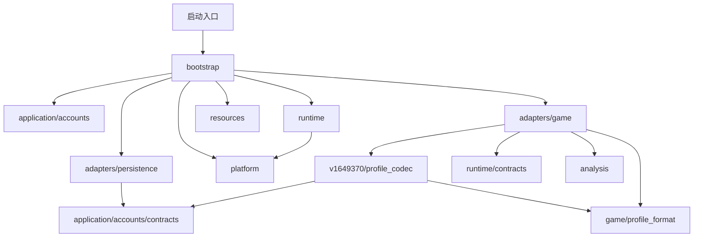
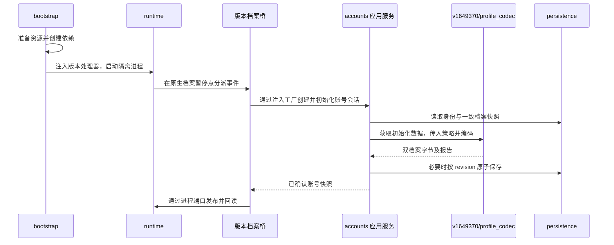
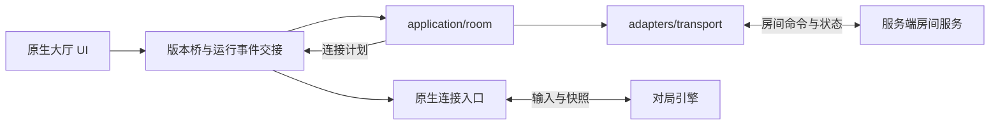

# 客户端架构设计

本文约定客户端模块的职责、依赖方向、状态归属和数据流，作为修改代码的依据。

原版客户端的主要功能、职责及当前接管情况见[原生客户端功能模块地图](原生客户端功能模块地图.md)。该地图是研究分类，不代表原厂源码分层，也不替代本文件的重建代码边界。


## 1 设计范围

当前实现面向 Windows 上的 1649370 客户端离线运行与本地档案。源码已按应用、外部适配、资源、平台、运行与装配职责组织。原生客户端继续负责 UI、房间对象、角色模型、档案消费和设备设置解释。

联机采用“本地账号与背包、服务端房间与对局”的分工。`application/room/` 与 `adapters/transport/` 已实现登录、创建、加入与退出房间。加入适配发布入房时的成员与设置快照；持续成员同步与战斗尚未接入。原生加入流程仍需双客户端实机验收。当前也没有通用多版本运行框架。

## 2 目录与职责

客户端磁盘目录按固定运行文件、持久数据和工作产物划分。下表路径相对于 `client/`；这些目录不新增源码架构层级。

| 目录 | 职责 | 边界 |
|---|---|---|
| `bin/` | 固定运行程序和组件 | 由启动装配使用；需要会话补丁的程序先复制到会话目录，不修改固定基底 |
| `resources/` | 固定运行资源及校验清单 | 由准备工具发布、资源层校验、bootstrap 装配；不承载源码、可执行组件或用户存档 |
| `data/` | 跨会话保存的账号、档案和设置 | 由持久化适配器管理、bootstrap 注入路径；不随缓存清理或资源重建而覆盖 |
| `workspaces/` | 构建中间材料、缓存和运行会话产物 | 按用途管理生命周期；清理须考虑工具及会话引用，不得遍历资源联接或删除跨会话数据 |

磁盘目录 `client/resources/` 存放运行数据，源码包 `client/src/codol_rebuild/resources/` 实现资源解析、供应和校验；`data/` 的业务和存储逻辑仍属于现有应用层与适配器。具体资源内容、处理流程与清单约定见[固定版本资源说明](../resources/v1649370/README.md)，工作产物说明见[工作目录说明](../workspaces/README.md)。

以下源码路径相对于 `client/src/codol_rebuild/`。

```text
codol_rebuild/
  application/
    accounts/
    room/               登录、创建、加入和退出房间
  adapters/
    persistence/
    transport/                 玩家 HTTP 接口与 WebSocket 连接生命周期
    game/
      profile_format/
      v1649370/
  resources/
  platform/
  runtime/
  bootstrap/
  analysis/
  core/
  cli.py
```

| 模块 | 应承担的职责 | 边界 |
|---|---|---|
| `application/accounts` | 本地初始化策略、昵称校验、档案保存用例、账号会话与 revision | 通过端口读取和保存不透明档案，不解释 DDL、原生地址或 SQL |
| `application/room` | 登录、创建、加入和退出房间；后台串行用例、身份持久化与不确定写入恢复；定义通信及身份存储端口 | 不实现传输，不拥有服务端房间规则，不直接读数据库 |
| `adapters/persistence` | SQLite 双档案、昵称、原生设置文件和历史归档 | 实现事务、版本冲突和文件校验，不决定等级或授权策略 |
| `adapters/transport` | 服务端业务 HTTP 连接、编解码、请求关联和传输错误；WebSocket 握手、后台接收、保活、重连与关闭 | 不修改本地背包，不访问原生内存，不承担实时战斗协议 |
| `adapters/game/profile_format` | 现有 DDL 布局的捕获、扫描与字段读写机制 | 由调用方提供容量与扫描指纹，不持有固定版本身份或账号策略 |
| `adapters/game/v1649370` | 固定地址、ABI、档案编码与策略映射、镜像、原生桥接、UI 规则与版本事件解释 | 实现账号格式端口，通过受控进程端口访问游戏，不创建数据库或拥有进程生命周期 |
| `resources` | Fastfile、资产解析、资源供应、资源库与缓存内容验证 | 不依赖应用、平台或宿主；系统权限由装配入口组合 |
| `platform` | Win32 签名、句柄基础操作、低权限令牌、ACL、目录联接 | 不包含游戏地址或账号业务 |
| `runtime` | 进程与守卫生命周期、调试循环、断点机制、周期调度、会话日志 | 不导入应用服务或固定版本实现，通过注入处理器分派事件 |
| `bootstrap` | 参数解析、依赖创建、资源准备步骤组合、版本选择与注入 | 不实现业务规则或调试事件循环 |
| `analysis` | 离线镜像恢复、静态分析 | 不运行游戏，依赖公共基础能力 |
| `core` | 输入基线、独立副本、公共路径锚点 | 不依赖上层，不收纳业务模型或共享可变状态 |
| `cli.py` | 离线分析命令分派 | 保持分析入口语义；运行装配由 bootstrap 承担 |

这些顶层目录分别表示业务用例、外部适配、宿主机制、资源能力和装配等职责，不是依次调用的流水线层级。`analysis/pe_recovery.py` 实现 PE 恢复与静态分析，`bootstrap/` 负责运行装配；两者名称不再共用 `bootstrap.py`。对外分析命令 `run.py bootstrap` 和已有报告格式继续保留。

`client/` 目录下的 `start_client.cmd` 调用同级 `tools/launch_client.py`，经预检进入 `bootstrap.launch.main`。`client/run.py` 保持分析命令外壳，`client/native/offline_guard.cpp` 提供断网守卫。正式自动化测试位于 `client/tests/`，入口为 `client/test.py`；专项验证代码位于 `verification/client/`，研究代码位于 `research/`，生产代码不反向依赖它们。

### 2.1 账号与格式边界

`application/accounts/policy.py` 决定初始角色、配装数量与选择、解锁策略。`service.py` 编排初始化、昵称修改和按版本保存；`AccountSession` 持有当前账号及昵称快照。

`adapters/game/v1649370/profile_codec.py` 实现账号格式端口，解释本版本游戏表、提供初始化数据，并通过 `profile_unlock.py` 将应用策略写入 DDL 字节。原生等级表示、字段路径和 UID 高低位转换属于本版本格式适配；固定容量、schema 身份及扫描指纹集中在 `layout.py`。业务层可以传递档案 bytes，但不能读取其偏移。

`adapters/game/profile_format/` 只承载当前 DDL 布局的通用捕获、扫描和字段访问机制。`capture_schema`、`classify_definition`、`select_definition` 显式接收容量上限，指纹查找显式接收扫描目标；该包不导入版本实现或账号应用服务。这不表示已经支持任意版本的 DDL 布局。

`contracts.py` 定义 `AccountStore`、`ProfileCodec`、`ProfileArchiveFormat` 以及格式／版本错误。双档案的 `identity/load/save` 与独立昵称版本语义保留；历史归档必须显式注入格式校验，不直接导入游戏格式实现。

新建账号的初始化版本、授权 ID 清单及 GP/CP 余额保存在同一 SQLite 数据库的 `account_initialization` 表，与双档案共享 revision 和事务。没有该记录的已有账号继续使用历史全解锁行为。新账号保留满级及进度条件，排位赛荣誉兑换物品优先授予，其余物品仅排除商城可通过 GP 或 CP 购买的物品；其他币种物品及非卖品全部授予（货币保留 ID 不作为仓库物品）。原生桥在发放库存前调用本版本 `LIST_TYPE_MARKET` 筛选器和 SKU 在售判定，保留原生时间、价格及排除条件；版本适配沿物品、产品、SKU 关联核对付款币种为 1（GP）或 2（CP），包括动态 SKU。物品若还关联有效的排位赛荣誉渠道（产品 unlockFlags ID 3、在售 SKU 币种 8/9），则不进入新档排除清单；完整检查所有关联产品，结果不依赖产品顺序。应用层据此选择初始授权和有效配装。重启读取已保存的授权，不重新按当日售卖清单发放。

仅在新建时将 GP 设为 2000000000（20 亿），CP 设为 100000。余额的有符号 32 位存储上限仍为 2147483647。版本适配将余额发布到原生类型 1（GP/codPoint）及类型 2（CP/moneyPoint）的账户记录，定期采样余额并经账号端口保存；不覆盖记录内的原生对象指针。测试启动使用 `verification/client/tools/verify_account_initialization.py` 重定向账号及设置数据库，不访问用户账号库。

本地购买由 `application/accounts/purchase.py` 校验商品全部内容、GP/CP、余额和已有授权，返回独立的新状态；`AccountSession.commit_purchase` 将扣款、永久授权与双档案一起按 revision 原子提交。选择的 SKU 期限仅作交易诊断信息，所有权仍保存为永久 `owned_ids`，不增加到期记录。没有初始化记录的历史全解锁档案不迁移、不重复收费。

`adapters/game/v1649370/purchase.py` 接管离线就绪状态下的 `MKT_BuyItem` 和 `MKT_UpdateInventory`。在游戏主线程调用原生 SKU 在售、报价、购买条件函数，按界面相同的正值条件选取折扣价。每次接收一份 SKU，支持单品和礼包内容；按原生堆叠标记区分永久授权与数量累加，不再整类排除类型 8。版本桥在暂停点暂存原生库存与余额，应用提交失败则恢复，成功后重建原生库存缓存，并用原有任务结果接口完成购买及后续刷新。`LocalProfileBridge` 持有目录快照并注入持久化调用，不让原生适配依赖数据库。验证入口为 `verification/client/tools/verify_purchase.py`，支持独立账号购买与 `--restore` 重启恢复验证。

本地购买支持单品及礼包：版本适配从产品内容列表读取物品，按原生标记识别可堆叠物品，按产品条目数量发放；底牌等非堆叠物品保存为永久授权。账号初始化状态的可选 `quantities` 字典以物品 ID 字符串记录数量，旧记录未提供数量时默认为 1。礼包一次扣款，已有永久装备去重，消耗品累加；全重复且无消耗品的礼包拒绝扣款。购买桥预检所有库存槽，写入全部数量与余额后提交现有 SQLite 事务，失败回滚原生数据。重启按授权和数量恢复库存。本期不实现消耗品使用效果；每次购买一份 SKU，选择的期限不产生到期记录。

购买成功后重建原生库存索引、发布 MY_ACCOUNT 余额并更新商品预览列表。商城成功回调恢复调用父类消息框。运行时电影补丁仍受原始字节、长度与压缩容量验证约束。


### 2.2 运行与装配边界

| 文件 | 责任 |
|---|---|
| `bootstrap/config.py` | 解析、联动和校验原有运行参数，不创建进程 |
| `bootstrap/resource_setup.py` | 依次组合独立文件、资源缓存、设置恢复、镜像补丁、ACL 与挂载 |
| `bootstrap/launch.py` | 创建账号服务工厂、进程会话和游戏事件桥，启动循环并执行收尾 |
| `runtime/contracts.py` | 定义进程访问、周期触发、调试控制和游戏事件端口 |
| `runtime/session.py` | `ProcessSession` 管理进程与守卫；`SessionLog` 管理运行目录、阶段计时和结果 |
| `runtime/debug_loop.py` | 接收系统调试事件，分派版本处理器，继续事件并管理断点 |
| `runtime/scheduler.py` | 决定周期任务是否到期，不解释采样内容 |
| `runtime/file_trace.py` | 保留原 Win32 返回值的文件访问诊断机器码机制 |

`runtime` 只调用版本处理器的公开方法，例如 `module_loaded`、`handle_exception`、`breakpoint`、`idle`，不读取其账号或房间内部状态。版本桥使用 `ProcessAccess` 和 `DebugControl`，不导入具体运行会话实现。退出后进程读写能力失效。

### 2.3 固定版本适配内部职责

以下路径相对于 `adapters/game/v1649370/`。

| 文件 | 责任 |
|---|---|
| `layout.py`、`observation_points.py` | 集中固定地址、布局、档案容量与 schema 身份／指纹、版本观察断点 |
| `image.py` | 镜像构建、固定基址与原字节校验、独立运行镜像补丁 |
| `session_bridge.py` | 注册版本事件、安装已有桥接能力、解释暂停点及原生 UI 完成时序 |
| `profile_bridge.py` | 编排档案准备、库存发布和就绪确认；拥有档案与库存快照，一致采样双档案并调用账号应用端口 |
| `profile_codec.py`、`profile_unlock.py` | 本版本账号格式端口、游戏表解释、初始化策略到 DDL 字段的映射与校验 |
| `profile.py` | 本地档案的原生初始化、库存布局与发布、余额读写和关联原生缓存操作 |
| `playlist.py` | 无赛季玩法 ID 的原生 ABI 适配与契约检查 |
| `local_ui_services.py` | 欢迎页和本地缺失在线服务的原生 UI 补丁 |
| `menu_preview.py`、`menu_queue.py` | 原生 UI 激活周期与菜单命令队列适配 |
| `viewer.py` | 按原生实际模式和数据就绪状态约束预览请求；集中预览观察点、状态和返回值解析 |
| `room.py`、`room_name.py` | 本地房间所有权、成员发布、离房续行及房间名任务桥 |
| `player_name.py` | 原生昵称 setter、编码、回读、补偿握手和 UI 规则 |
| `purchase.py` | 原生购买参数、SKU 报价及条件、永久库存发布与回滚、购买和库存刷新回调 |
| `ui_navigation.py`、`sanitize.py` | 大厅空赛季导航与离线字符串净化方法规则 |
| `ui_movie.py` | 收集规则、校验资源、检查重叠、压缩并生成显式写计划 |

`session_bridge` 协调这些能力，不复制它们的机器码生成算法。档案暂停点只委派给 `LocalProfileBridge.prepare_native` 和 `complete_native`，购买报价也通过档案桥的公开方法取得，不读取或改写其内部目录、schema、库存或账号服务。`profile_bridge` 在原生校验及就绪标志回读完成后才发布就绪状态；账号保存版本属于 `AccountSession`。供诊断读取的结构化属性返回独立快照，不能用于修改桥内状态。日志记录结果，不作为跨模块账号状态仓库。

## 3 依赖关系

箭头表示源码依赖，省略公共 core 依赖。接口由使用能力的一方定义，外部实现依赖接口，由 bootstrap 注入；运行时调用方向可能与源码依赖方向相反。



| 调用方 | 允许依赖 |
|---|---|
| `application` | 自身应用包的契约与规则、`core`；跨应用协作优先注入端口 |
| `adapters/persistence` | 自身、应用存储／格式契约、`core` |
| `adapters/transport` | 自身、联机端口与数据契约、`core` |
| `adapters/game/profile_format` | 自身、`core` |
| `adapters/game/v1649370` | 自身、格式适配、应用契约、`runtime/contracts`、`analysis`、`core` |
| `runtime` | 自身、`platform`、`core` |
| `resources`、`platform`、`analysis` | 自身、`core` |
| `core` | 自身 |
| `bootstrap` | 上述各层的公开接口 |

不允许应用层导入 SQLite、Win32、socket 或 DDL 实现；不允许运行层导入版本桥或账号服务；不允许适配器导入 bootstrap。禁止全局服务容器及通过任意修改共享 Context 形成隐式依赖。目录初始化文件不应隐式装配具体实现。

通信关系：`application/room/contracts.py` 定义端口，`adapters/transport/http.py` 实现，`bootstrap` 注入。实际请求由联机服务发起，不由 bootstrap 代替业务执行。`adapters/persistence/server_identity.py` 原子保存按服务器地址隔离的明文身份和房间恢复记录；`platform/machine_identity.py` 读取 SMBIOS UUID 并产生摘要，由装配入口作为值传入应用层。

大厅列表通过 `RoomPort.begin_list/poll_list/cancel_list` 独立提交和消费，
与登录、建房、离房和设置共用串行工作线程。一次刷新收齐分页后才发布，
重复刷新只保留最新意图；取消在当前 HTTP 请求结束后生效。查询有 20 秒
分页预算、100 页及 1000 房间上限，超过上限报错，不发布截断列表。
`adapters/game/v1649370/room_list.py` 负责原生查询调用边、模式过滤与 GFx
数组转换，复用 `cppSetRoomData` 通知；页面隐藏、切换或建房会撤销发布。
服务端房间 ID 保留为字符串，列表索引只是本地展示位置。`room.py` 在
AS_JoinRoom 的数字转换前捕获 ID 与密码，`multiplayer_bridge.py` 经应用端口
异步加入，使用独立加入通知链发布快照，不冒用创建房间回调。原生值类型
成员数组容量为 19；快照超出容量或存在不可表示字段时拒绝发布并尝试离房。
本机成员保留本地角色资料，其他成员只填身份与昵称，房主身份独立映射；
当前不包含实时成员变化、其他玩家的角色档案、观战、对局或奖励结算。

加入请求发出前原子保存目标房间和 `uncertain_join` 恢复标记，不保存密码。
响应丢失时查询目标详情确认本人是否已入房；尚未观察到成员不能证明请求
未执行，必须保留恢复记录。只有确认入房后离房成功、或确认房间已不存在/
关闭，才清理未知加入记录。明确拒绝则恢复请求前记录。旧身份文件默认
`uncertain_join=False`，无需迁移。取消与迟到响应通过同一退出用例清理，
普通成员的设置写入在应用层和原生桥均被拒绝。

`adapters/game/v1649370/multiplayer_bridge.py` 负责原生请求快照、主线程完成投递和字符串 playerId 到原生64位显示标识的稳定映射。原生房间模块的可选延后分支保留创建任务和离房任务，前端帧桥消费后台结果后调用原有成功或失败回调。登录成功前不激活大厅，避免 UI 缓存临时身份；业务身份与原生显示标识不混用。`RoomSession` 的业务状态只在单个工作线程更新，原生桥只经 `begin`/`poll` 交互，网络线程不访问游戏进程。

## 4 状态归属与一致性

| 状态 | 所有者 | 一致性要求 |
|---|---|---|
| 本地账号、双档案与 revision | `AccountSession` 与账号存储 | 公开／安全档案原子提交；提交成功才推进内存版本 |
| 显示昵称与昵称 revision | 账号应用服务与存储 | 与账号键 `local`、配装版本分离；发布失败不能报成功 |
| DDL schema 与字段解释 | 格式适配 | 版本、容量与字段类型不符时拒绝解释 |
| 本地房间与成员对象 | 原生客户端；版本桥记录适配所有权 | 检查双向指针和活动状态，离房后旧所有权失效 |
| 原生档案就绪、库存边界与采样基线 | `LocalProfileBridge` | 准备、发布及就绪确认由同一所有者完成；未就绪不保存；双重读取变化或边界损坏时拒绝提交 |
| UI 激活周期、菜单提交与 schema 捕获状态 | `GameSessionBridge` 及相应原生标志 | 前一周期成功且原生自行复位才允许下一次；不重复初始化档案 |
| 设置文件与稳定采样基线 | 设置持久化会话 | 二进制保存、稳定采样、同文件冲突检查及备份 |
| 进程句柄、守卫、待继续事件 | `ProcessSession` | 未确认守卫不恢复主线程；结束时释放句柄和守卫 |
| 断点与文件陷阱 | `DebugLoop` | 在有效暂停点恢复原字节和线程上下文 |
| 共享资源 | 资源缓存及平台权限机制 | 客户端只读，独立配置可写 |

## 5 关键数据流

### 5.1 启动与档案初始化



进程数据与业务输入在版本／格式边界转换。应用层不接收进程句柄。参数和数据路径由 bootstrap 明确提供，不依赖当前工作目录。

### 5.2 档案保存与昵称修改

周期触发 → 版本桥一致采样与库存边界检查 → 格式适配检查 schema 和角色字段 → 账号服务比较已保存快照 → 存储原子提交 → 更新内存 revision。读取不稳定时本次不保存，失败不能推进版本。

昵称请求 → 版本桥读取原生输入 → 账号服务校验 → 原生 setter 应用并回读 → 暂存改名卡移除 → 昵称及库存同事务提交 → 重建库存索引和预览 → 原生任务成功通知。提交失败恢复卡片与旧名并复核；补偿失败中止会话。改名卡（50001）由版本适配识别，应用层移除其授权及数量记录；存储层同时比较昵称与账号 revision 并递增两个版本。不新增购买或无卡 UI 限制，沿用原界面限制。原生槽仅清空授权字段、保留已构造对象，后续购买优先复用空槽。当前已显示昵称通过既有资料更新事件刷新。

### 5.3 本地房间与界面

原生房间名请求 → 本地校验完成任务 → 原生创建对象 → 本地创建完成适配 → 成员构造与发布 → 原生角色缓存和槽加载 → UI 展示。

成员身份应贯穿玩家 ID、房主、成员和发布读取；单人 ID `1` 只属于离线命名空间。离房时清理适配所有权并保留原生完成通知续行。对象清空不能替代页面退出成功。

无赛季玩法 ID 在原生读取及有效性查询边界适配；UI 空赛季日期访问通过方法规则保护，不伪造完整赛季对象。

### 5.4 主电影与背包改名

功能模块提供等长替换规则 → `ui_movie` 收集、核验资源身份和完整指纹、拒绝区间重叠并检查压缩容量 → 版本桥在加载边通过进程端口写入会话副本并回读 → 原生加载。

背包改名复用原有事件与档案保存链路。离线净化完成事件携带 `sanitized=false`，表示未过滤；不提供在线敏感词服务。该流程与玩家昵称任务分离，不修改磁盘电影资源。

### 5.5 资源与设置

资源清单及源库 → 内容校验和缓存发布 → 缓存保护 → 独立会话目录 ACL → 只读目录联接 → 原生读取。配置、可执行文件、组件、overlay 与可写目录保持独立。

缓存以清单 SHA-256 定位，复用时检查文件身份、大小、mtime、ctime；变化时重新校验内容，`--verify-resources` 强制全量复核。元数据快速路径不承诺识别同用户刻意伪造全部元数据的修改。挂接失败中止，清理联接时不能遍历缓存目标。

设置数据库 → 恢复完整二进制文件至会话 players → 客户端读写 → 每两秒稳定采样 → 事务保存。正常退出采集最终文件，强制终止仅尝试保存此前稳定内容；保留校验、冲突检测和最近二十份旧文件备份。内存中尚未写文件的设置不在保存范围。

## 6 联机扩展边界

### 6.1 状态权威

| 数据 | 权威来源与客户端职责 |
|---|---|
| 本地账号、昵称、背包、保存的配装 | 本地应用和存储；网络失败不得覆盖本地档案 |
| 联机身份与准入 | 服务端分配和校验；与本地 UID 分开映射 |
| 房间成员、队伍、准备、地图、模式 | 服务端；客户端保存带 revision 的展示快照 |
| 本场装备 | 本地提交必要字段，服务端检查兼容性后冻结；本地后续修改不直接改变本局 |
| 对局地址、代次及凭据 | 服务端；客户端验证与当前流程匹配后调用原生连接 |
| 战斗现场和本场结果 | 服务端引擎；首期不自动修改本地经验或库存 |

### 6.2 通信与线程边界



业务通信和原生实时通信分别验证。网络线程不得直接读写游戏对象，也不得阻塞 UI 或调试暂停点。通过有界事件队列，在已验证的执行点调用版本桥。

命令关联请求 ID 与会话代次，房间事件关联房间 ID 和 revision；取消、离房和新开局使旧流程失效。缺失事件时重新获取快照。发送成功不等于入房成功，开局响应不等于原生连接成功。写命令只能在服务端去重契约下重试。

业务断线时停止房间变更，标明状态未知；恢复后重新同步。不能把业务断线直接当作战斗连接断线。首期不承诺战斗重连，失败时释放本场连接、保留本地档案并重新确认准入。

### 6.3 运行模式

离线模式保留游戏进程的全面断网守卫。当前房间接入由 Python 宿主发送 HTTP，游戏进程继续受守卫限制且保持 `DW=0`；没有移除检查或伪造原在线登录状态。未来原生战斗连接仍需独立批准目标地址放行和握手接入。

组合入口按模式选择房间完成数据供应方，不能同时执行本地模拟成功和服务端完成。服务端返回的地址必须符合目标范围，凭据不写入完整日志。具体传输协议与原生握手尚待验证。

当前 [服务端设计](../../server/docs/架构设计.md) 仍采用服务端账号／档案权威假设，联调前须同步调整；本次客户端重构不修改服务端。

## 7 路径与验证约束

`core/paths.py` 的 `REBUILD_ROOT` 继续指向 `client/`，`PROJECT_ROOT` 指向项目根。固定资源和清单位于 `client/resources/v1649370/`，账号与设置数据库位于 `client/data/accounts/`；可重建缓存和会话日志仍位于 `client/workspaces/`。清理会话不得删除跨会话数据；历史证据不批量重写路径。

`client/tests/test_architecture.py` 实际扫描正式模块，校验层间依赖、禁止旧包引用、模块导入和路径锚点；扫描数量必须非零。差分验证使用隔离的历史源码夹具，比较原生生成器、安装写入顺序和真实档案初始化结果。它们不构成正式依赖。

任何新增正式模块或职责扩展按项目 AGENTS.md 提交方案。静态检查、模拟进程和原生 ABI 夹具不替代游戏内界面验收；最新测试与实机状态记录在问题解决文档，架构文档只保留稳定职责和契约。

玩家昵称改名保存成功后，版本适配的 UI 成功回调广播现有 `EVT_ON_CAREER_INFO_UPDATED`；已激活名片组件通过自身监听者重取玩家对象并更新文本，业务与持久化层不直接操作界面。

