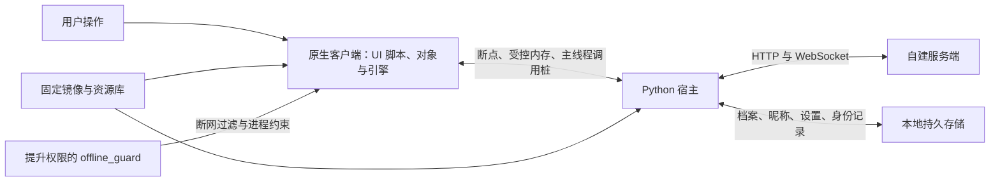
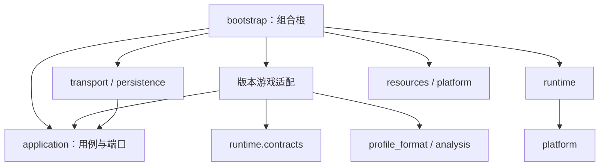
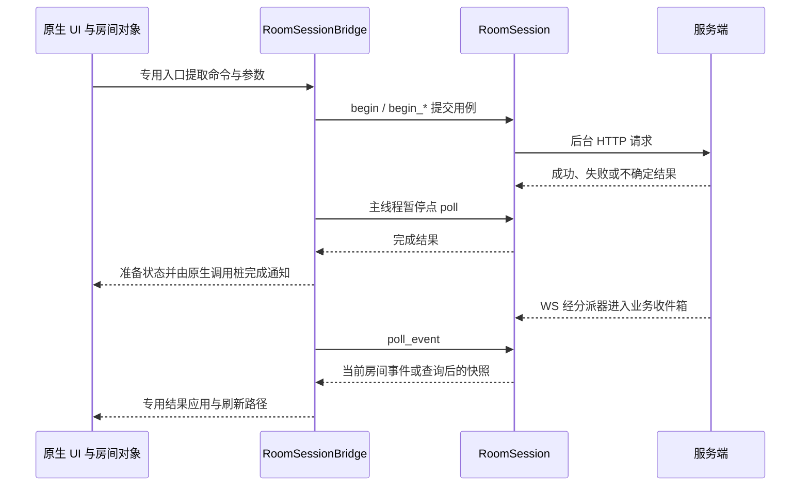

# 客户端架构设计

调查日期：2026-10-27。适用对象：当前 `client/` 源码及 CODOL 1649370 固定版本原生客户端。

本文描述已经存在的实现、依赖边界与限制，作为后续开发的定位入口；不将目标架构或历史验收结果写成当前事实。依据为源码静态阅读及本次架构测试，没有启动游戏、连接服务端或执行多客户端界面验收。原生功能调查另见[原生客户端功能模块地图](原生客户端功能模块地图.md)，其中的历史接入状态应结合当前源码判断。

## 1. 系统定位与进程边界

当前客户端采用“Python 宿主 + 固定版本原生游戏 + 离线守卫”的结构，复用原版 UI、UI 脚本、档案对象、房间对象、角色展示和引擎能力。Python 应用层接管本地账号及已接入的联机用例，版本适配层在特定原生入口提取参数、发布结果并完成通知。

原生客户端不是纯展示层：用户输入、原生初始化、成员刷新和任务完成都可能继续触发原生业务。修改功能时必须同时检查用户命令、原生自动行为、服务端回显三条路径。

图中表示运行关系，不表示代码允许双向导入。游戏进程以低权限令牌运行并被守卫限制联网；联机请求由 Python 宿主发出。守卫使用 UAC，宿主本身保持当前用户权限。

## 2. 目录与职责

生产 Python 包根目录为 `client/src/codol_rebuild/`。

| 目录 | 当前职责 | 主要入口或组件 |
| --- | --- | --- |
| `bootstrap/` | 组合根：参数、资源装配、依赖创建、启动与清理 | `launch.run`、`config`、`resource_setup.prepare` |
| `application/accounts/` | 本地账号初始化、授权、余额、购买、消耗、昵称和联机改名用例 | `AccountSession`、`policy`、`purchase`、`RenameSession` |
| `application/session/` | 登录、确认身份交接、首次 WS 握手、旧房间恢复与退出顺序 | `OnlineSession`、`contracts` |
| `application/room/` | 房间请求、确认归属、恢复标记、列表及成员刷新、准备和换队等用例 | `RoomSession`、`RoomPort`、`Gateway` |
| `application/realtime/` | 单一实时消息入口及按业务类型分派 | `RealtimeDispatcher`、`EventInbox` |
| `application/chat/`、`broadcast/` | 聊天发送/接收协调、广播发送任务和消息消费 | `ChatSession`、`BroadcastSession` |
| `adapters/transport/` | HTTP 请求与响应校验；WS 连接、收发队列、保活和重连 | `HttpGateway`、`WebSocketConnection` |
| `adapters/persistence/` | SQLite 事务、身份 JSON、档案归档及设置文件持久化 | `AccountRepository`、`JsonIdentityStore`、`SettingsSession` |
| `adapters/game/profile_format/` | 档案 schema、字段访问、扫描、解锁及格式编解码 | `schema`、`fields`、`scan`、`account_codec` |
| `adapters/game/v1649370/` | 地址、对象布局、原生补丁、参数转换、受控调用和通知 | 见下节 |
| `runtime/` | 通用进程会话、调试事件循环、内存访问、断点和周期任务 | `ProcessSession`、`DebugLoop`、`ProcessAccess`、`DebugControl` |
| `platform/` | Win32、低权限令牌、资源 ACL、目录联接、运行目录独占租用和机器指纹 | `win32`、`resource_mount`、`runtime_directory`、`machine_identity` |
| `resources/` | 资源解析、提取、库清单与共享库校验 | `fastfile`、`assets`、`runtime_cache`、`offline_resources` |
| `analysis/` | 输入/启动分析和 PE 恢复能力 | `bootstrap`、`pe_recovery` |
| `core/` | 路径锚点与输入基线 | `paths`、`baseline` |

包外目录按用途划分：

| 位置 | 用途 |
| --- | --- |
| `client/start_client.cmd`、`tools/launch_client.py` | 用户启动入口及启动预检 |
| `client/run.py`、`src/codol_rebuild/cli.py` | 版本检查和分析命令入口，不是常规游戏启动入口 |
| `client/tools/` | 启动及资源准备工具 |
| `client/native/offline_guard.cpp`、`client/bin/` | 守卫源码、守卫程序和固定原生镜像 |
| `client/resources/v1649370/`、`client/manifests/` | 固定版本资源、运行依赖、补丁和版本清单 |
| `client/workspaces/` | 会话、资源校验记录、缓存和构建材料；不能一概视为可删除缓存 |
| `client/tests/` | 正式测试及冻结夹具，独立于生产源码 |
| `verification/client/` | 专项验证工具、报告、日志及临时工作目录 |
| `research/` | 探索性分析、实验和原型 |

### 2.1 固定版本适配内部划分

| 位置 | 职责 |
| --- | --- |
| 根级 `layout.py`、`image.py`、`native_state.py`、`movie_identity.py`、`observation_points.py` | 版本公共地址、镜像准备、状态区约定、UI 资源身份与观察点 |
| `accounts/` | 档案初始化与桥接、昵称、商城购买、充值及授权转换 |
| `rooms/` | 房间生命周期、列表、成员档案、成员菜单、设置、准备与换队的原生适配 |
| `chat/` | 普通聊天、广播及对应 UI 消息结构 |
| `frontend/` | 大厅、导航、角色预览、玩法列表、通知、主题及 UI 局部修补 |
| `session/` | 版本内装配、公共前端帧调度、登录结果适配和 UI 资源补丁协调 |

`session/session_bridge.py` 中的 `GameSessionBridge` 负责版本内安装顺序和事件路由；`accounts/profile_bridge.py` 中的 `LocalProfileBridge` 自己管理档案准备、发布、就绪与保存状态。会话桥通过其公开生命周期接口协作。

## 3. 依赖方向与接口

所有层还可按现有规则使用 `core`。主要约束由 [test_architecture.py](../tests/test_architecture.py) 的 `ALLOWED` 和专门断言表达：

- `application` 只依赖应用层和 `core`，不读取游戏地址，不使用 SQLite、Win32 或具体网络实现。业务接口通常在各职责的 `contracts.py` 中；当前 `RenameGateway` 例外，定义在 `accounts/rename.py`。
- `adapters.persistence`、`adapters.transport` 通过应用层契约实现端口，不反向装配应用服务。当前存在导入 `application.errors` 的规则偏差，详见第 10 节。
- 固定版本游戏适配可依赖应用层、档案格式和分析能力；对运行层只允许依赖 `runtime.contracts`，进程访问能力由组合根注入。
- `runtime` 依赖 `platform` 和 `core`，不导入版本地址或本地账号业务；`resources`、`platform`、`analysis` 各自在本层及 `core` 范围内组织。
- 版本根级公共模块不反向导入功能包；功能包不导入 `session` 装配包；版本内部依赖不得成环。
- 生产代码不得依赖测试、验证、研究代码。版本包的 `__init__.py` 只声明用途，不隐式装配或提供旧路径别名。

应用层通过 `Protocol`、完成结果对象及显式回调协作。`bootstrap/launch.py` 创建实际网关、存储和用例并注入桥接对象；业务结果返回原生的方向不会因此形成反向代码依赖。

## 4. 启动与退出生命周期

1. **入口与预检。** `start_client.cmd` 使用 PATH 中的 `python`，读取 `client/config/server.ini` 的 IP 和端口，传入资源库、本地档案和服务器参数。`tools/launch_client.py` 检查固定镜像 SHA-256、五项补丁记录、必要文件和宿主参数，生成启动计划。`--dry-run` 在这一阶段结束。
2. **资源准备与程序复用。** `bootstrap.launch.run` 创建独立 `SessionLog`；标准模式校验 `resources/v1649370/game` 后，按基底、补丁和资源清单指纹租用 `workspaces/runtime-programs/<指纹>/slot-编号/runtime`。新槽位只准备一次 EXE、根级运行依赖及磁盘补丁；已完成槽位校验后直接复用，复制量为零。资源仅在 `main`、`hires`、`client_shipretail`、`locales` 四个顶层建立联接。每次会话仍在自己的 `runtime/players` 恢复设置，程序目录的 `players`、`appdata`、`localappdata`、`temp` 顶层联接指向该会话。准备日志区分 `runtime-program-install`、`runtime-program-reuse` 和 `session-settings-and-mounts`；资源扫描和程序摘要检查仍会耗时。启动与验收工具统一使用完整资源库；旧 overlay、分库、按需补件和预热启动分支已移除。`--prepare-only` 准备后释放租用，不创建游戏进程。
3. **依赖装配。** 本地账号通过工厂创建 `AccountSession(AccountRepository, AccountCodec)`。指定 `--server-url` 时另行创建登录、房间、改名、聊天、广播、HTTP/WS 和事件收件箱；未指定服务器时保留本地流程。
4. **创建进程与守卫。** `ProcessSession.start` 以低权限令牌和挂起/调试方式创建游戏，设置会话私有环境目录。运行目录锁的无读写权限句柄副本交给游戏进程，使宿主提前退出时槽位仍保持独占直至游戏结束。多开使用其他空闲槽位。守卫仅额外接受本项目固定层级的程序槽位，仍核对目标 PID、创建时间、过滤器和作业约束后才恢复主线程。
5. **原生初始化。** `DebugLoop` 接收系统调试事件，`GameSessionBridge` 检查镜像基址并在 CRT 等指定暂停点安装适配。正式入口由原生流程衔接启动动画与界面，不额外排入主菜单命令，避免干扰动画显示；档案和预览就绪检查、原生初始化调用及完成通知继续参与后续激活。原宿主的额外菜单命令注入参数及实现已删除。
6. **持续运行。** 调试循环驱动原生事件，公共前端帧轮询联机结果，空闲阶段及周期任务保存档案和设置；关键事件写入会话日志。
7. **收尾。** 可用条件下先尝试档案 checkpoint，再关闭原生进程、保存设置和回收守卫。联机会话等待登录收尾、清理房间、关闭 WS，随后关闭改名/广播任务、释放运行目录租用并生成结果日志。退出清理失败会记录错误，不等同于成功离房。

固定基底不直接接受运行补丁；可复用程序槽位承载一次性的磁盘补丁，原生内存承载运行适配。版本适配包含原字节检查、容量检查和写入回读等保护，但并非通用版本兼容机制，不能直接换用其他客户端镜像。

## 5. 线程、事件与原生完成路径

宿主调试线程处理游戏暂停事件并读写目标内存；原生函数调用桩在游戏线程继续执行后运行。二者不是同一个线程。涉及主线程的适配在相应执行点检查线程身份，不能将网络后台线程直接用于原生调用。

| 执行位置 | 承担工作 | 结果交接方式 |
| --- | --- | --- |
| 宿主调试循环 | 断点管理、参数提取、内存发布、版本事件解释 | 注入桥接对象、状态区和受控调用桩 |
| 登录/房间等应用工作线程 | HTTP 请求、身份保存、恢复与业务协调 | `begin_*` 提交，`poll_*` 读取已完成任务 |
| WS 后台线程 | 连接、收发、Ping/Pong、退避重连 | 线程安全收发队列 |
| 原生前端主线程 | 原生对象更新、刷新和任务成功/失败通知 | `session_tick.build_tick` 生成的公共帧包装及功能调用桩 |

公共帧先执行既有预览入口，检查档案就绪，并按帧计数节流；随后处理登录、广播、改名、实时业务、成员/准备/设置发布、房间请求完成和聊天。具体顺序以 [session_tick.py](../src/codol_rebuild/adapters/game/v1649370/session/session_tick.py) 为准，属于原生生命周期约定，不能任意重排。

实时下行先由 `RealtimeDispatcher` 唯一读取传输队列，每次 `poll` 分派一条消息，再交给独立 `EventInbox`：

| 事件 | 接收业务 |
| --- | --- |
| `chat_message` | 聊天 |
| `broadcast` | 广播 |
| `room_settings_updated`、`room_members_updated`、`room_kicked`、`room_closed` | 房间 |

房间等待请求期间不会抢走聊天或广播消息。WS 当前接收/发送队列各有 256 条上限；发送队列满或连接不可用时发送入口可能直接返回，重连建立新发送队列，不重放旧连接未发内容。连接恢复不等于业务消息可靠补发，也不等于全量房间状态重新同步。

## 6. 状态归属与持久化

| 状态 | 维护者与来源 | 原生侧用途或更新方向 |
| --- | --- | --- |
| 本地 public/secure 档案、授权、余额 | `AccountSession` 与 SQLite 已提交快照；原生编辑通过桥采集保存 | 初始化时发布；运行中合法档案变更经校验回存 |
| 原生 schema、库存和目录就绪 | `LocalProfileBridge` 与版本格式适配 | 服务于原生对象初始化、显示和快照转换 |
| 服务端玩家身份 | 登录响应；`OnlineSession` 获取并交接，JSON 保存 | 游戏适配生成原生身份表示，不用它替代服务端 `playerId` |
| 房间归属及不确定操作记录 | 服务端结果与 `RoomSession`；`IdentityRecord` 保存恢复信息 | 恢复记录不是已经确认的当前房间 |
| 联机房间设置、成员、准备和队伍 | 服务端结果；应用层协调，游戏桥保存展示所需副本 | 服务端快照经版本转换进入原生房间及 UI |
| 游戏设置文件 | `SettingsStore` / `SettingsSession` 与运行目录文件 | 启动恢复，运行 checkpoint，使用冲突检测保存 |
| 连接状态 | `WebSocketConnection` | 用例及适配通过公开状态接口判断连接可用性 |

路径由 [core/paths.py](../src/codol_rebuild/core/paths.py) 统一定义。**当前持久目录为 `%APPDATA%/CODOL/data/accounts/`**，主要文件为 `local.sqlite3`、`game-settings.sqlite3` 和默认 `server-identities.json`，不是 README 中仍写的 `client/data/accounts/`。服务端身份文件可通过参数指定；不得假定多个进程共用该 JSON 文件具有事务隔离。

账号存储使用修订号冲突检测，初始化数据和档案可在同次事务中提交。`AccountSession` 在保存成功后更新已提交快照；昵称和改名道具消耗通过专门保存路径协调。`ProfileStore` 是另一个档案归档适配，不能与默认运行账号 SQLite 混为一谈。

## 7. 主要业务流程

### 7.1 本地账号、档案与商城

原生档案准备暂停点捕获 schema、表和目录，`LocalProfileBridge` 使用注入工厂创建账号服务。`AccountCodec` 将业务策略转成档案字段和原生库存；初始化完成后才推进就绪状态。应用层不解释原生字段偏移。

现行初始化策略见 [policy.py](../src/codol_rebuild/application/accounts/policy.py)：

- 新账号保留最高进度策略，初始授权筛选非预留且非 `marketplace_only` 的物品；此分类由适配层提供，不在应用层硬编码原生分类数字。
- 初始角色及五套配装选择已有授权内容；GP 为 2,000,000,000，CP 为 100,000，只在新账号创建时发放。
- 带有 `initialization` 的账号验证并保留授权/余额；历史无该状态的档案走既有初始化策略，不统一重置为新账号。
- 装备购买增加永久授权，消耗品维护数量；每次支持一份商品，包含礼包内容。全已拥有的非堆叠商品拒绝重复购买，交易检查价格、币种和余额。
- 本地充值只增加 CP，当前按钮单次增加 1,000，受整数余额上限限制；不代表接入真实支付。

商城的原生商品解析与回调位于 `accounts/purchase.py`，纯交易规则位于 `application/accounts/purchase.py`。联机改名另由 `RenameSession` 协调服务端结果，游戏桥再与本地昵称及道具处理衔接；它不是整个本地账号已迁移到服务端的证明。

### 7.2 登录与大厅激活

公共帧通过 `OnlineSessionBridge` 提取已恢复的昵称，发起一次登录。后台读取按规范化服务器地址保存的身份，携带机器指纹和既有 `playerId` 登录；获得响应后先交接身份并保存，再完成 WS 首次握手与旧房间恢复。成功结果回到游戏桥后，通知房间、改名、聊天和广播适配，并设置登录完成门控。

机器指纹由平台层读取 SMBIOS 系统 UUID 并形成摘要；原生身份表示由玩家 ID 转换而来，两者不能互换。当前登录失败不会自动再次发起；首次登录响应完全丢失时，客户端可能尚未获得可保存的玩家 ID，不能声称已有完整幂等恢复。

WS 普通断线采用最高 30 秒间隔的退避重连；关闭码 4401 或重连时 HTTP 401/403 导致身份失效并停止重连。传输层不负责自动重新登录或直接退出原生房间。

### 7.3 房间命令、原生自动行为与回显

当前源码已经接入创建、列表、加入、退出、设置同步、成员档案、换队、准备、踢人及被动离房路径。入口证据包括 `RoomSession`、`HttpGateway`、`RoomSessionBridge`、`room_list.py` 和 `room.py`，不能继续以旧 README 的“仅创建与退出”概括。

| 路径 | 当前处理及边界 |
| --- | --- |
| 创建 | 从原生房间读取人数、密码、设置和本人成员档案；先保存不确定建房标记，响应后保存房间 ID，再走原生完成路径 |
| 加入 | 保存目标与不确定入房标记；响应丢失时查询成员确认，不能因一次查询尚无成员就删除恢复记录；已取消的原生加入结果另行清理远端归属 |
| 主动离房 | 服务端完成后进入原生离房成功路径；失败走任务失败通知，不当作已经离房 |
| 被踢/关房 | 匹配当前房间后清理本地归属并发布被动离房，不再次发送离房请求，也不重复投递已有的成功通知 |
| 成员更新 | WS 通知触发后台查询房间详情及成员档案，再发布快照；换队/准备结果和成员通知按现有顺序消费，避免部分旧结果覆盖 |
| 原生成员刷新 | `applying_members` 门控避免成员回显诱发设置再提交；成员及准备通知继续由专用原生路径执行 |
| 设置提交 | 房主原生设置本地先执行；桥在身份就绪、无主流程及非成员应用期间异步补交，不按值相同去重 |
| 设置回显 | 检查当前房间，转换模式、地图及标量字段，设置发布标志；公共帧执行 `settings_apply`，不直接重走用户提交入口 |

**设置路径的现有限制：** 设置提交忙时记录 `skipped`；提交失败只记录结果，不回滚已经本地生效的原生设置，也没有在此路径自动重试。因而不能宣称本地设置始终等于服务端确认状态。通用原生配置入口也不能仅凭一次拦截命中认定为用户意图；新增接入仍需逐项调查调用来源。

恢复流程用于清理旧房间再继续，不是断线自动回到原房间。建房不确定时分页查询本人房间；离房失败保留恢复记录。成员/设置检查具有房间 ID 与对象生命周期保护，但这些检查不构成所有业务消息的全局版本排序或全量重同步协议。

### 7.4 聊天与广播

普通聊天由 `ChatSession` 使用 WS 发送端口，并结合确认房间及当前展示房间过滤消息；游戏适配负责原生消息结构、显示和清理。广播由 `BroadcastSession` 在工作线程发送 HTTP 请求，下行经广播收件箱消费，原生 `BroadcastBridge` 通过注入的档案消耗接口协调道具。二者共享实时连接，但不共享业务收件箱；广播发送和本地物品消耗跨越服务端与本地存储，不应描述为跨系统数据库事务。

## 8. 资源、隔离与运行产物

普通启动使用完整的 `resources/v1649370/game/` 原生资源树。`resources.native_library` 负责固定版本来源、原生覆盖选择和批量发布；`runtime_cache` 负责运行前清单与内容校验，平台层承担 ACL 与挂载，组合根安排先后顺序。全量准备工具为 `tools/prepare_native_resources.py`，从既有提取材料构建，运行时不依赖提取材料。

- 常规模式的共享资源仅联接 `main`、`hires`、`client_shipretail`、`locales` 四个顶层目录；根级依赖在新程序槽位首次准备后复用，资源树内无嵌套联接和资源硬链接。`main/fileSysCheck.cfg` 是只读探测资源；玩家设置和临时状态通过各自顶层联接进入独立会话目录，持久设置仍在系统用户目录的数据库中。
- 普通启动读取资源清单及装配依赖，不扫描完整资源树、不比较全库校验记录，也不逐项检查素材路径；运行程序副本的既有校验保持不变。`--verify-resources` 显式执行完整路径、文件集合和 SHA-256 复核，并设置资源权限、在 `workspaces/resource-library-verification/` 保存记录。普通启动不再通过全库校验设置源库权限。
- 已删除旧分库、overlay、按需补件及预热启动入口，验收脚本统一使用完整资源库。旧库、提取材料和历史报告保留用于资源来源比对；独立的资源构建工具不属于启动流程。
- 每次运行写入 `workspaces/offline-runs/<会话名>/`，包含 `runtime/`、`events.jsonl`、`result.json`、资源引用清单及守卫状态等材料。
- 完整资源输入受固定版本清单约束；清理会话不能递归穿过资源联接删除源库。

原生守卫、低权限令牌、运行目录 ACL 和禁止模块检查共同构成当前运行约束。它们不证明游戏功能正确，也不代表宿主 HTTP/WS 使用了完整生产级账号认证体系。

## 9. 测试与验证层次

正式入口为 `client/test.py`，自动发现 `client/tests/test_*.py`，禁用字节码写入，将测试临时目录设在 `verification/client/workspaces/test-temp/`。可用 `--output` 保存到尚不存在的报告文件。依赖见 [requirements.txt](../requirements.txt)，测试环境说明见 [tests/README.md](../tests/README.md)。

| 验证层次 | 现有代表测试 | 能证明什么 |
| --- | --- | --- |
| 应用与存储 | `test_account_initialization.py`、`test_purchase.py`、`test_room_service.py`、`test_online_session.py` | 策略、保存、用例状态及失败处理的测试场景 |
| 网络与事件 | `test_multiplayer_http.py`、`test_multiplayer_websocket.py`、`test_refactor_events.py` | 网关行为、连接机制、事件分派场景 |
| 版本与原生夹具 | `test_room_list_native.py`、`test_room_team_native.py`、`test_room_ready_native.py`、`test_chat_native.py` | 对应字节、布局、调用桩或原生夹具约定；不等于手工界面验收 |
| 资源与架构 | `test_runtime_cache.py`、`test_resource_separation.py`、`test_architecture.py` | 清单/缓存规则、路径和静态依赖边界 |
| 实机与多客户端 | `verification/client/` 专项工具及人工验收 | 实际点击、原生自动行为、通知顺序与多人状态同步，必须单独记录环境和结果 |

新增验收应覆盖用户主动操作、初始化、服务端回显、重复或迟到消息，并检查请求次数、状态一致性、对象生命周期和通知顺序。静态补丁校验、模拟网络及原生夹具均不能替代完整原生 UI 与多客户端验证。

## 10. 本次核查结果与已知偏差

本次执行现有 `test_architecture.py`：**8 项，7 项通过，1 项失败**。失败发生在 `test_production_dependency_direction`：`adapters/transport/http.py` 导入 `application.errors.OnlineError`，而测试要求传输/持久适配导入的应用模块必须以 `.contracts` 结尾。静态阅读可见 `websocket.py` 也有同类导入；测试在首个断言处停止，不能据此推断只有一个违规位置。此处记录实现与规则的差异，没有修改生产代码或测试规则。

本次通过的其余检查涉及版本包无环依赖、包初始化无副作用、中文模块说明、基础路径锚点、旧包路径检查及模块导入、运行层隔离和档案桥状态边界。未运行完整测试套件，未验证启动资源完整性，也未进行原生界面或对局验收。

现有 README 与部分模块说明存在历史信息：仍描述固定 Python 路径、项目内持久目录、未实现加入房间/成员同步，以及服务端不保存地图模式等；当前启动脚本、`core.paths`、房间接口和桥接代码已不同。本文以当前源码为准，不把旧说明作为实现缺失的证据。

目前代码证明的是本地运行、档案/商城与大厅房间协作等接入路径，不能由此认定完整战斗、地图加载、对局同步与结算闭环已经完成。设置失败纠正、连接恢复后的业务状态补齐、身份失效后的业务处理以及跨系统操作一致性仍需按具体调用链另行设计或验证。

## 11. 后续改动的落点

业务规则放入职责匹配的 `application` 模块；网络格式与连接机制放入 `adapters/transport`；持久事务放入 `adapters/persistence`；版本参数、字段、补丁和原生通知放入固定版本适配；对象生命周期和全局安装顺序由对应桥及组合根协调。

按照项目协作约束，生产修改应先调查，再提出具体方案并取得批准；新增生产模块必须说明职责、路径和依赖。原生接入需明确保留/接管的自动行为，用户命令和服务端结果分开处理，补丁覆盖范围保持最小。稳定回归进入 `client/tests/`，专项验证与探索分别放入 `verification/client/` 和 `research/`，不得让生产代码反向依赖这些目录。
